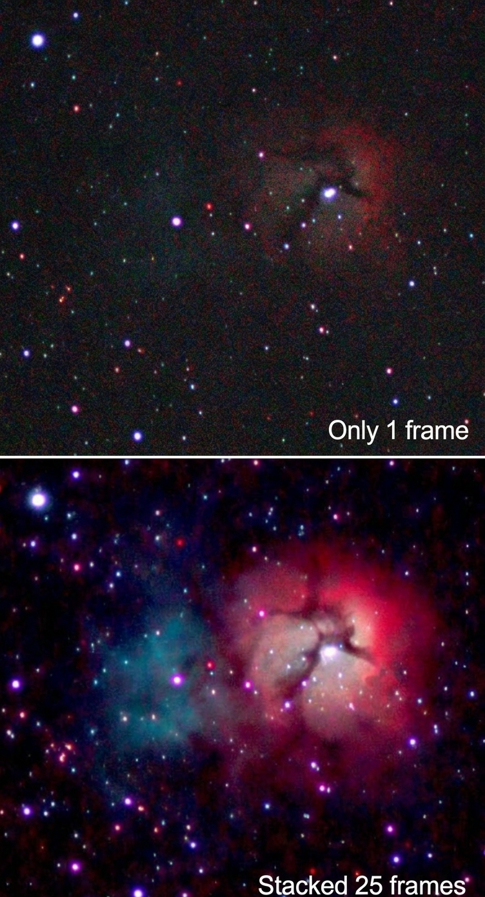
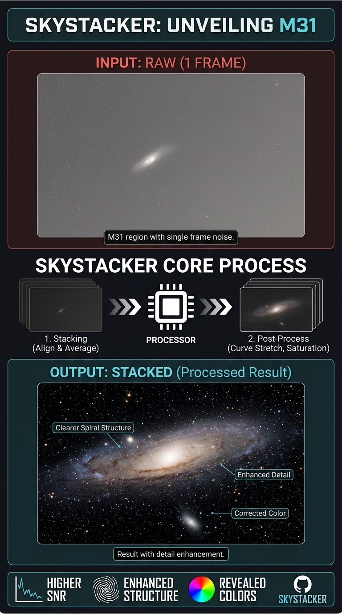
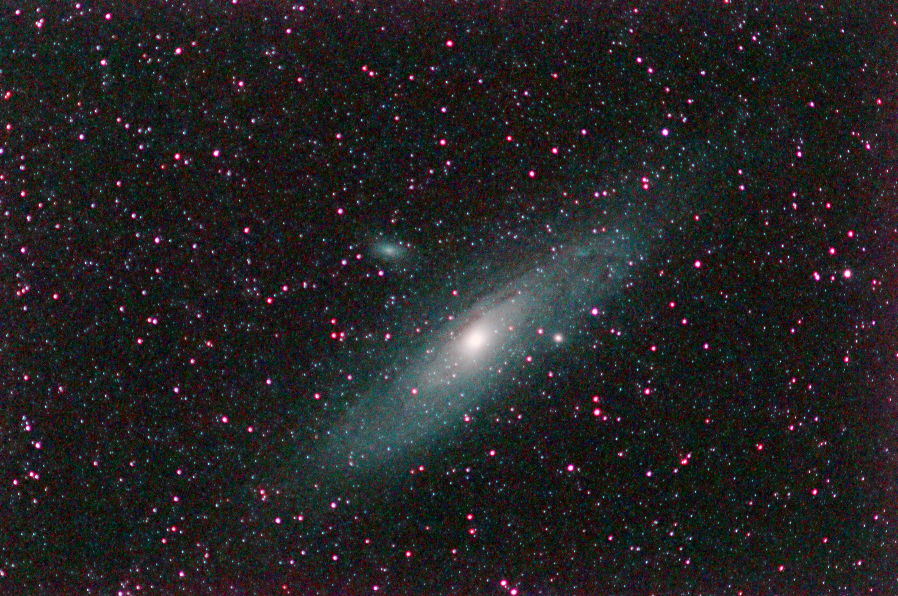
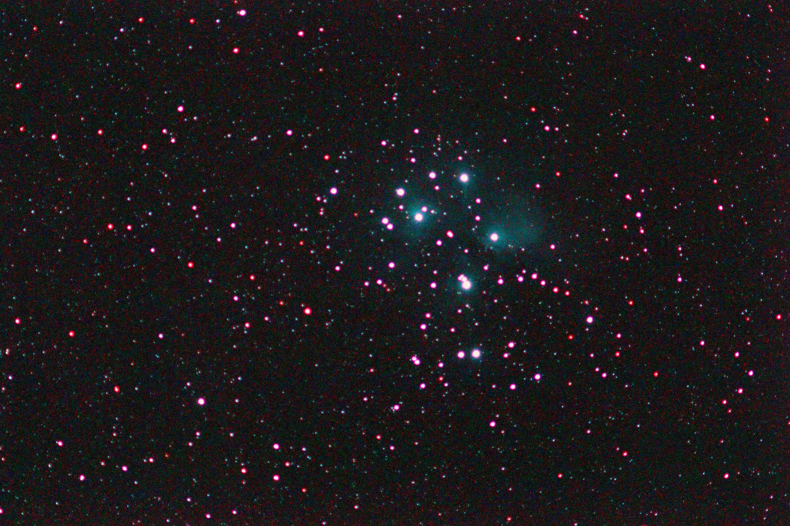
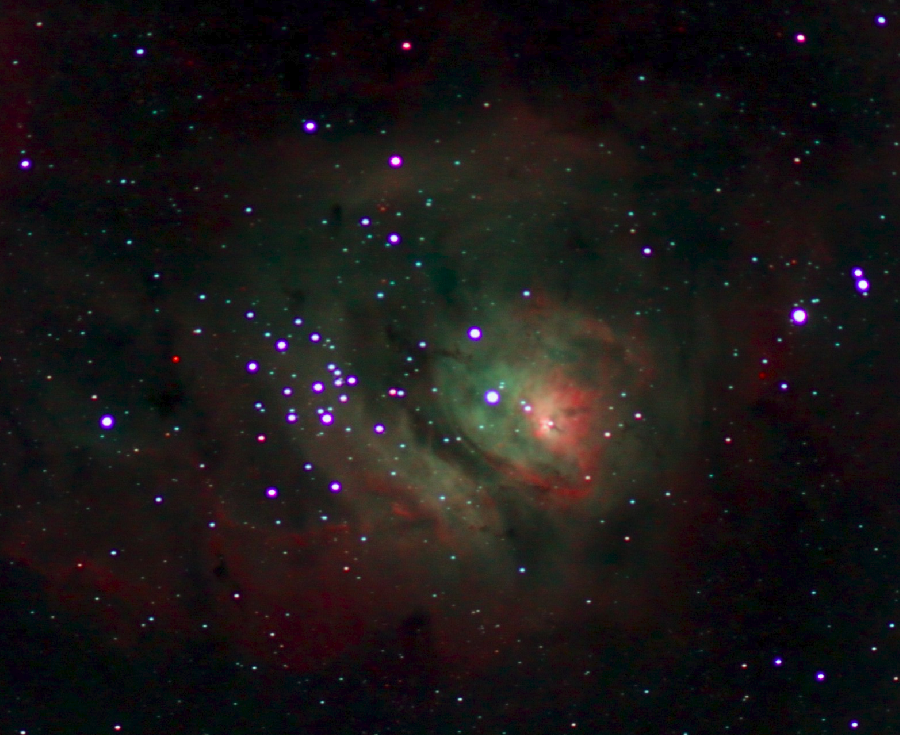
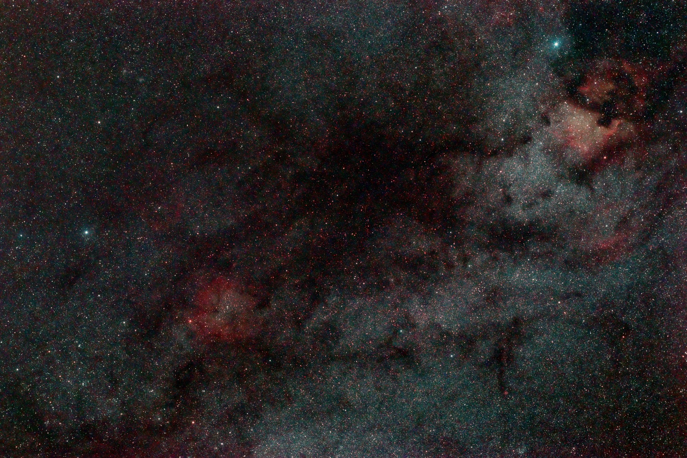

# SkyStacker

**SkyStacker is a local-first command-line tool for stacking astrophotography images.**  
It takes a folder of night-sky exposures, detects stars, aligns the frames, combines them into useful image stacks, and can apply an automated post-processing workflow.

<p align="center">
  
</p>
<p align="center">
  <em>Stacking multiple frames dramatically improves signal-to-noise ratio and reveals faint structure (Trifid Nebula, 1 frame vs. 25 frames).</em>
</p>

<p align="center">
  
</p>
<p align="center">
  <em>From a folder of individual exposures to aligned stacks and processed astrophotography images.</em>
</p>

[](https://opensource.org/licenses/MIT)
[](https://go.dev/)
[]()

---

## Table of Contents

- [Gallery](#gallery)
- [What does SkyStacker do?](#what-does-skystacker-do)
- [Scope & Architecture](#scope--architecture)
- [Main Capabilities & Algorithms](#main-capabilities--algorithms)
  - [Frame Registration](#frame-registration)
  - [Calibration](#calibration)
  - [Stacking Methods](#stacking-methods)
  - [Frame Normalization (Optional)](#frame-normalization-optional)
  - [Post-Processing Pipeline](#post-processing-pipeline)
  - [Astrometric Plate Solving & Gaia DR3 Layer](#astrometric-plate-solving--gaia-dr3-layer)
- [Supported Input Formats & Requirements](#supported-input-formats--requirements)
- [Build & Verification](#build--verification)
- [Quick Start & Examples](#quick-start--examples)
- [Command-Line Options](#command-line-options)
- [Output Structure](#output-structure)
- [Processing Pipeline at a Glance](#processing-pipeline-at-a-glance)
- [Pre-Flight Resource Checks & Error Handling](#pre-flight-resource-checks--error-handling)
- [Development Status & Recently Implemented (v0.6.1)](#development-status--recently-implemented-v061)
- [Planned Potential Features and Technologies Roadmap](#planned-potential-features-and-technologies-roadmap)
- [How SkyStacker Compares](#how-skystacker-compares)
- [Benchmarks](BENCHMARKS.md)
- [Research](research/README.md) (incl. [Gemini deep-research prompt](research/GEMINI_DEEP_RESEARCH_PROMPT.md))
- [Project Goals & License](#project-goals--license)

---

## Gallery

Examples of results produced with SkyStacker. More images will be added over time.

<table>
  <tr>
    <td align="center">
      <br>
      <strong>Galaxy — Andromeda (M31)</strong><br>
      <small>Spiral galaxy — the nearest large galaxy to the Milky Way, with visible dust lanes and companion M32.</small>
    </td>
    <td align="center">
      <br>
      <strong>Open Cluster — Pleiades (M45)</strong><br>
      <small>Young open star cluster surrounded by a blue reflection nebula of dust illuminated by the hot stars.</small>
    </td>
    <td align="center">
      <br>
      <strong>Nebula — Lagoon (M8)</strong><br>
      <small>Emission nebula and active star-forming region; the red Hα glow comes from ionized hydrogen gas.</small>
    </td>
    <td align="center">
      <br>
      <strong>Wide-field — North America Nebula region</strong><br>
      <small>Rich Milky Way field in Cepheus showing the North America Nebula (NGC 7000) and surrounding dust lanes.</small>
    </td>
  </tr>
</table>

---

## What does SkyStacker do?

Astrophotography sessions usually produce many individual exposures of the same region of the sky. Even when the camera or mount moves slightly between exposures, the stars should occupy the same positions in the final combined image.

SkyStacker automates the core workflow:

1. **Discovers input frames** in a session directory.
2. **Decodes the images** and prepares their pixel data in linear floating-point precision.
3. **Optionally calibrates** light frames using dark, flat, and bias frames.
4. **Detects stars** and selects a reference frame.
5. **Registers the frames** by matching star patterns and estimating geometric transformations.
6. **Resamples and aligns** the exposures before combining them.
7. **Creates image stacks** using the selected statistical method, plus maximum- and minimum-pixel combinations.
8. **Optionally post-processes** the resulting image to improve its background, colour, contrast, and detail.
9. **Writes outputs and a processing report** to a results directory.

The aim is to provide a transparent, reproducible, and resource-conscious workflow that runs locally, without requiring a cloud service.

---

## Scope & Architecture

- **Single-file, zero-dependency Go binary**: Implemented in `main.go` using the Go standard library only, compiling to a standalone cross-platform CLI executable (`skystacker`).
- **Linear float32 pipeline**: Accumulates and processes image data in IEEE 754 `float32` precision end-to-end.
- **Current boundaries**:
  - **CLI-only**: No GUI is included.
  - **External RAW decoding**: Native JPEG and native FITS decoding (with ImageMagick fallback) are built in; CR2/CR3 RAW decoding is delegated to `dcraw`/`dcraw_emu` or ImageMagick at runtime.
  - **Drizzle & SIP resampling**: Drizzle and Bayer drizzle are not wired. SIP order-2 is applied in WCS forward/inverse helpers (`wcsTanForward`, `wcsTanInverseSIP`) used by plate-solve/diagnostics; the stacking resampler (affine/similarity warp to the reference frame) still uses the linear TAN path unless redesigned.
  - **Seeded plate solving**: Whole-sky blind plate solving is out of scope; `--plate-solve` requires a pointing seed (`--plate-center` or FITS `RA`/`DEC` headers) because blind mode scans only a 3×3 `nside=64` neighbourhood around `(0,0)`.

---

## Main Capabilities & Algorithms

### Frame Registration

- **Automatic star detection**: Identifies 8-connected components above `sigma * noise` (default `5.0σ`, with automatic multi-sigma retries at `4.0`, `3.5`, and `3.0` if fewer than 20 stars are found), where `noise` is the MAD of a high-pass residual (box blur radius `clamp(min(W,H)/200, 8, 24)`).
- **Reference-frame selection**: Automatically picks the frame with the highest number of detected stars, or uses an external image with `--reference-crop`.
- **Reference-frame crop (`--reference-crop`)**: Detects stars in the supplied reference image, matches each light by triangle pattern, and warps it in memory into the reference pixel frame. The output has exactly the reference dimensions; source files are never modified. Works with rotation and scale differences (0.5×–2×), and with a single light (`--limit 1`) to produce a standalone cropped frame. This is the automatic counterpart of Fitswork's manual two-star crop.
- **Triangle-based pattern matching**: Constructs triangles from the top **40** brightest stars using scale-invariant side-ratio descriptors `(short/long, mid/long)` bucketed on a `0.01` grid with `0.02` tolerance.
- **Geometric transform estimation**: Computes a closed-form similarity transform (rotation, scale, translation) via least squares with RANSAC-style inlier filtering, plus optional full 6-DOF affine refinement (retained only when residual error drops by ≥ 10% with ≥ 15 inliers).
- **Sub-pixel resampling & safe crop**: Uses bilinear sub-pixel resampling and computes the largest fully valid overlapping rectangle (`findSafeCrop`, maximal-rectangle-in-histogram).
- **Fallback & diagnostics**: Frames that cannot be registered are logged in `report.txt` (with limiter flags such as `LOW QUALITY` `< 30`, `LOW BOX%` `< 50%`, and `LARGE OFFSET` `|drift| > 10%` of reference dimensions) and excluded from the registered stack while still contributing to the unregistered mean.

### Calibration

Calibration frames can be supplied explicitly:

- **Dark frames** help correct sensor dark signal and hot pixels.
- **Flat frames** help correct illumination variation and vignetting.
- **Bias frames** can be used with flat calibration.

You can pass individual calibration paths (`--dark`, `--flat`, `--bias`) or use `--calib-root` to let SkyStacker auto-discover `Bias/Darks/Flats/<filter>` subfolders under a common directory.

- **Exporting masters (`--export-masters`)**: Writes each loaded calibration product as `master_<kind>.f32raw` (scientific float32 format with the same header as `_work` files) plus a `master_<kind>.jpg` preview. The preview maps the 1st..99.5th luminance percentile linearly to `0..255` and is intended for inspection only.
- **Synthetic self-flat (`--self-flat`)**: Derives a relative illumination map from at least 15 registered dithered lights.
  - **v1 (`--self-flat-model=registered`)**: Built in reference coordinates and applied after registration, so it corrects mosaic-level vignetting rather than sensor-level fixed-pattern noise; a loaded flat always wins. Because a flat built from lights can absorb extended structures common to every frame (for example a large nebula—reaching a ratio near `1.9` around M42 on Orion-135mm), inspect the crop-sized `master_self_flat.f32raw` (using the crop rectangle in `report.txt`) before trusting the correction. Only the registered stack is corrected.
  - **Sensor-space grid (`--self-flat-model=grid`, default)**: Full-frame estimator built from unregistered frames and applied before resampling. It uses a local-contrast source mask (so extended emission is not masked like a star), a SExtractor-style cell mode with a low-quantile consistency check, 5x5 median/MAD cell rejection, and a degree-4 Chebyshev fit refined by asymmetric Huber IRLS. `report.txt` includes the fit RMS, an ordinary least-squares RMS, a radial-model RMS, the IRLS iteration count, min/max, and the coefficients. It is not the default yet: the remaining work is Phase 4 in `research/04-calibration-and-self-flat.md` and `ROADMAP_SYNTHETIC_CALIBRATION.md`.

### Stacking Methods

| Method | Execution Model | Purpose |
| --- | --- | --- |
| `mean` | Streaming (single buffer per frame, divided by valid pixel count) | Arithmetic average of registered frames; minimal disk overhead. |
| `median` | Tiled, out-of-core via `_work/_spill1` and `_work/_spill2` (~256 MB tile cap) | Median combination, useful for rejecting transient features. |
| `sigma` *(default)* | Tiled MAD-based rejection (`σ = 1.4826 × MAD`), quality-weighted | Rejects outliers (`|v - median| > threshold × σ`, default `3.0σ`, `2` iterations) such as hot pixels, satellite trails, and cosmic rays. |

SkyStacker also calculates **maximum-pixel** and **minimum-pixel** combinations in Pass 1 across all accepted frames. These are useful for inspecting transient features (e.g., meteors/satellites) and background behaviour, though they are diagnostic combinations rather than substitutes for a normal integration.

### Frame Normalization (Optional)

Sessions where individual frames have different sky brightness or transparency benefit from background normalization before stacking (requires registration; no-op when `--no-register` is set):

- **`--normalize`**: Per-frame global `scale + offset` matching each frame's background luminance `(median, MAD)`—computed on a 1024-bin histogram with 4× subsampling—to the reference frame (`scale = ref.MAD / frame.MAD` clamped to `[0.5, 2.0]`, `offset = ref.median - scale * frame.median`). Takes ~1 ms/frame and handles uniform sky-glow drift and transparency swings.
- **`--local-normalize`**: Per-tile `scale + offset` with bilinear interpolation across tile centers (`--ln-tile-size`, default `256` px). Handles spatially varying gradients (light pollution, changing vignetting direction). Implies `--normalize`.

The reference frame itself is never normalized; every other frame is matched to its background prior to accumulation or spilling.

### Post-Processing Pipeline

SkyStacker includes an 8-step automated post-processing workflow (plus optional flag-gated stages):

1. **Background removal**: Robust 2nd-degree 2D polynomial fit (`--bg-degree` 1–3) to 32×32 block samples (20th percentile per channel) with 3 iterations of outlier rejection above `2σ`. `--mask-bg` excludes pixels above `0.1` luminance.
2. **Star removal**: High-pass star detection replaced by the median of an annulus scaled by star radius (`--star-radius`, `--star-sigma`).
3. **Black-point shift**: Subtracts the `--bg-percentile` luminance percentile (default `10`), held in memory for step 4.
4. **STF/MTF auto-stretch**: PixInsight-style Screen Transfer Function / Midtone Transfer Function (`--stf-shadows` default `-2.8`, `--stf-target` default `0.25`; `--stf-linked` applies a single shared transform across RGB channels).
5. **Guided-filter denoise**: Per-channel self-guided filter (He et al. 2010) for `--denoise-strength` passes (radius `--denoise-radius`, default `3`), followed by a two-scale chroma-only pass (radii `24` and `96`, `eps = 0.005`) to suppress low-frequency colour blotches (`--denoise-chroma`).
6. **Curves**: Applies `x' = clamp((x - black) / (1 - black), 0, 1); out = x'^gamma` (`--curves-black` default `0.03`, `--curves-gamma` default `1.20`) identically per channel.
7. **HDR blend**: Combines stretched and linear-background detail via `out = clamp(step6 + hdrBlendFactor * step1, 0, 1)` (`--hdr-blend-factor` default `1.0`).
8. **Weighted mix & diffraction spikes**: Produces 4 preview variants `w*step1 + (1-w)*step7` for `w ∈ {0.90, 0.80, 0.70, 0.60}` (unless `--no-hdr-mix`), and optionally renders additive diffraction spikes on bright stars (ON by default; disable with `--no-spikes`).

Additional optional stages can be toggled via CLI flags: chromatic-aberration reduction (`--post-ca`), colour calibration (`--post-color`), vignette/background flattening (`--post-flatten`), unsharp-mask sharpening (`--post-sharpen`), HDR local-contrast enhancement (`--post-hdr`), and three-level contrast stretching (`--post-stretch`). Run `skystacker --help` for the exact options in your build.

### Astrometric Plate Solving & Gaia DR3 Layer

- **WCS solver (`--plate-solve`)**: Solves a TAN WCS astrometric solution after stacking using star pattern matching against Gaia DR3, writing `plate_solution.json` (including fitted SIP order-2 distortion coefficients). Supply `--plate-center RA,DEC` in decimal degrees or rely on the reference frame's FITS `RA`/`DEC` header keywords. With `--post-only`, the solver runs on stars detected in the existing `_work/stacked_mean.f32raw` (requires `--plate-center`; no FITS header available).
- **HEALPix & TAP client**: Implements the HEALPix nested scheme (`nside` power of 2 from `2` to `8192`, default `64` at ~0.84 deg² per tile) and queries ESA's Gaia TAP `/sync` endpoint with a 180 s per-attempt timeout, 5 s progress heartbeat, automatic retries (`2 s` / `4 s` backoff on 5xx/network errors), and 1 req/sec rate limiting.
- **Persistent tile cache**: Since Gaia DR3 is a frozen catalogue, downloaded tiles are cached permanently in your OS user cache directory (`~/.cache/skystacker/gaia_cache/` on Linux, `~/Library/Caches/skystacker/gaia_cache/` on macOS), enabling offline operation with `--gaia-offline`.

---

## Supported Input Formats & Requirements

SkyStacker currently discovers these file extensions:

- `.jpg` and `.jpeg` (decoded natively via Go's standard image packages)
- `.png` (decoded natively)
- `.fit` and `.fits` (decoded natively with ImageMagick fallback)
- `.ser` (FireCapture/Lucam SER; expanded to one frame per `#frame=N`)
- `.cr2` and `.cr3` (decoded via external `dcraw`, `dcraw_emu`, or ImageMagick at runtime)

### External Tools

On Debian/Ubuntu, install ImageMagick:

```bash
sudo apt update
sudo apt install imagemagick
```

For Canon RAW files, SkyStacker prefers `dcraw` or `dcraw_emu` when available in `PATH`. Install a compatible RAW decoder if your system does not already provide one.

> **Note:** Exact RAW/FITS decoding capabilities depend on the ImageMagick delegates and RAW decoder installed on your system. A file extension alone does not guarantee that a particular camera file can be decoded.

### System Requirements

- **Go 1.20 or later** (to compile from source).
- **Runtime decoders**: ImageMagick and/or `dcraw` / `dcraw_emu` for RAW/fallback FITS ingestion.
- **Memory & Disk**: Sufficient RAM and scratch disk space for the session's frame count and image dimensions (see [Pre-Flight Resource Checks](#pre-flight-resource-checks--error-handling)).

---

## Build & Verification

Clone the repository and build the executable:

```bash
git clone [https://github.com/computerphysicslab/skystacker.git](https://github.com/computerphysicslab/skystacker.git)
cd skystacker

go build -ldflags "-X main.buildDate=$(date -u +%Y-%m-%dT%H:%M:%SZ)" -o skystacker .
```

Run the embedded unit & integration self-tests (authoritative count printed at runtime; `runSelfTests` in `main.go` is the source of truth):

```bash
./skystacker --selftest
```

Print the version or command-line help:

```bash
./skystacker --version
./skystacker --help
```

### Startup Banner

On every run, SkyStacker prints a one-line banner to standard error:

```text
SkyStacker 0.6.1 | [https://github.com/computerphysicslab/skystacker](https://github.com/computerphysicslab/skystacker) | built 2026-11-15T00:00:00Z
```

To embed the real build time when building directly from `main.go`:

```bash
go build -ldflags "-X main.buildDate=$(date -u +%Y-%m-%dT%H:%M:%SZ)" -o skystacker main.go
```

Without `-ldflags`, SkyStacker falls back to the VCS commit timestamp embedded by Go when building from a Git checkout, or prints `unknown`.

---

## Quick Start & Examples

### Basic Stacking

Place the light frames from an imaging session into a directory:

```text
M31-session/
├── light_001.jpg
├── light_002.jpg
├── light_003.jpg
└── ...
```

Run the default workflow (`sigma` clipping + full post-processing):

```bash
./skystacker ./M31-session
```

By default, results are written to `M31-session/0_skystacker_results/`.

Common workflow variations:

```bash
# Choose a stacking method (mean, median, or sigma)
./skystacker --method mean ./M31-session
./skystacker --method median ./M31-session
./skystacker --method sigma ./M31-session

# Specify a custom output directory and allow overwriting existing outputs
./skystacker --output ./results/M31 --overwrite ./M31-session

# Search subdirectories recursively
./skystacker --recursive ./M31-session

# Stack frames only (skip post-processing)
./skystacker --stack-only ./M31-session

# Re-run post-processing on existing _work/stacked_mean.f32raw without re-stacking
./skystacker --post-only ./M31-session
```

### Calibration Example

Organize light and calibration frames in separate directories:

```text
M31-session/
├── lights/
│   ├── light_001.cr2
│   ├── light_002.cr2
│   └── ...
└── calibration/
    ├── darks/
    ├── flats/
    └── bias/
```

Supply calibration files or folders explicitly:

```bash
./skystacker \
  --dark ./M31-session/calibration/darks/master-dark.fit \
  --flat ./M31-session/calibration/flats/master-flat.fit \
  --bias ./M31-session/calibration/bias/master-bias.fit \
  ./M31-session/lights
```

Or let SkyStacker auto-discover `Bias/`, `Darks/`, and `Flats/` subdirectories under `--calib-root`:

```bash
./skystacker \
  --calib-root ./M31-session/calibration \
  ./M31-session/lights
```

> **Tip:** Match calibration frames to your light frames in camera model, sensor temperature, exposure duration, ISO/gain, and optical train.

### Reference-Frame Crop Example

```bash
# Stack a session but keep exactly the framing of a reference image.
./skystacker \
  --reference-crop ./reference/M31-framing.jpg \
  ./M31-session/lights

# Crop one image to the reference frame without stacking a session.
./skystacker \
  --reference-crop ./reference/M31-framing.jpg \
  --limit 1 \
  --stack-only \
  ./single-exposure
```

The reference image is star-matched automatically; the light frames are warped in memory and the originals are never modified. The frame-exact result is also written as `reference_crop.f32raw` and `reference_crop.jpg`.

### Normalization & Plate Solving Example

```bash
./skystacker \
  --local-normalize \
  --plate-solve \
  --plate-center 10.6847,41.2687 \
  --tiff \
  --png \
  ./M31-session/lights
```

### Comet Tracking Example

```bash
# Pixel mode (reference frame coordinates, EXIF times)
./skystacker --comet-center 1200,800 --comet-rate 0.02,-0.01 ./lights

# RA/Dec rate mode (requires plate solve)
./skystacker --plate-solve --comet-radec 83.822,22.0145 --comet-sky-rate-arcsec 2.5,-0.3 ./lights

# Ephemeris file (lines: ISO8601 RA_deg Dec_deg; # comments allowed)
./skystacker --plate-solve --comet-target ./comet_ephem.txt ./lights
```

`comet_ephem.txt` example:

```text
# time UTC RA_deg Dec_deg
2026-01-01T00:00:00Z 83.800 22.010
2026-01-01T00:30:00Z 83.805 22.012
```

Comet-aligned outputs are written as `stacked_comet.f32raw`/`stacked_comet.jpg` when enabled (if EXIF `DateTimeOriginal` is missing for a frame, reference time is used with a warning unless `--comet-ephem-strict-exif` is set, in which case the run fails).

---

## Command-Line Options

```bash
skystacker [flags] [input-directory]
```

The input directory defaults to `.`. Flags may be passed before or after the positional input directory.

### Core & Execution

| Flag | Description | Default |
| --- | --- | --- |
| `--config file.json` | Load flags from a JSON object (keys without `--`); explicit CLI flags win | — |
| `--resume` | If the output dir already has a stacked float32 image, continue with post-processing instead of re-stacking | `false` |
| `--drizzle-upsample N` / `--drizzle-pixfrac F` | Diagnostic drizzled N× upsample (`stacked_drizzled.f32raw/.jpg`), N=1 off | off / `1.0` |
| `--output string` | Output directory | `<input>/0_skystacker_results` |
| `--method string` | Stacking method: `mean`, `median`, or `sigma` | `sigma` |
| `--workers int` | Maximum number of concurrent worker goroutines | Number of CPUs |
| `--recursive` | Search input subdirectories recursively | `false` |
| `--overwrite` | Permit replacing existing files in the output directory | `false` |
| `--no-register` | Disable star-based registration | `false` |
| `--reference-crop string` | Warp every light into the star-matched pixel frame of this reference image; output size equals the reference size | — |
| `--scale int` | Downscaling factor (`2` halves each dimension, `4` quarters it) | `1` |
| `--force` | Bypass pre-flight out-of-memory and disk-space safety checks (not recommended) | `false` |
| `--no-exif` | Skip EXIF exposure summary in `report.txt` | `false` |
| `--clean` | Remove `_work` directory after a successful run | `false` |

### Calibration

| Flag | Description | Default |
| --- | --- | --- |
| `--dark string` | Dark frame file or directory path | — |
| `--flat string` | Flat frame file or directory path | — |
| `--bias string` | Bias frame file or directory path | — |
| `--calib-root string` | Root directory containing `Bias`/`Darks`/`Flats` folders | — |
| `--export-masters` | Write `master_<kind>.f32raw` + `.jpg` preview for loaded calibration products | `false` |
| `--bpm-auto` | Derive a bad-pixel map from the master dark (or bias) via `median + N*sigma*MAD` | `false` |
| `--bpm-auto-sigma float` | Sigma threshold for `--bpm-auto` | `5.0` |
| `--self-flat` | Derive a relative illumination flat from ≥ 15 dithered lights (auto when no flat loaded) | `true` (auto) |
| `--self-flat-model string` | Self-flat model: `grid` (default, Phase-3 sensor-space with IRLS) or `registered` (v1 compatibility) | `grid` |
| `--self-flat-linear-srgb` | Experimental: apply grid self-flat in linear light via sRGB EOTF (approximation; off by default) | off |
| `--hfr-quality` | Use median star HFR (`FWHM ≈ 1.995·HFR`) instead of blob size for advanced frame-quality weighting | `false` |
| `--annotate` | Project cached Gaia stars through the plate solution into `stacked_annotated.jpg`; write unmatched detections to `anomalies.json` (offline) | `false` |
| `--starless` | Write `stacked_starless`/`stacked_stars` `.f32raw` + `.jpg` from the post-processing star-removal step | `false` |
| `--json-report` | Write `report.json` alongside `report.txt` (same `processingReport` data) | `false` |
| `--bg-multiscale` | Remove a coarse 20th-percentile background grid before the polynomial fit | `false` |
| `--deconvolve` | Richardson-Lucy deconvolution with Gaussian PSF after background removal (CPU-heavy) | `false` |
| `--deconv-sigma float` / `--deconv-iters int` | PSF sigma (px) and RL iterations | `1.5` / `3` |
| `--narrowband M` + `--nb-a/--nb-b/--nb-c` | HOO/SHO mapping from three mono `.f32raw` stacks (`_work/stacked_narrowband.f32raw` written) | — |
| `--wavesharp` / `--wave-gains` | Classical multi-scale Gaussian detail enhancement (coarse-to-fine gains, BXT-like baseline) | `false` / `0.25,0.15,0.08` |

### Normalization

| Flag | Description | Default |
| --- | --- | --- |
| `--normalize` | Per-frame global `scale + offset` background match to reference (requires registration) | `false` |
| `--local-normalize` | Per-tile `scale + offset` with bilinear interpolation; implies `--normalize` | `false` |
| `--normalize-mode string` | `scale-offset` (default), `additive` (median shift), or `multiplicative` (clamped median ratio) | `scale-offset` |
| `--normalize-per-channel` | Independent per-channel normalization (global only; overrides local) | `false` |
| `--ln-tile-size int` | Tile size in pixels for `--local-normalize` | `256` |

### Stacking & Cache

| Flag | Description | Default |
| --- | --- | --- |
| `--sigma-clip float` | MAD sigma-clipping rejection threshold (`0` disables) | `3.0` |
| `--sigma-clip-iters int` | Number of sigma-clipping iterations | `2` |
| `--sigma-clip-low float` | Asymmetric low-side sigma threshold (`0` = use `--sigma-clip`) | `0` |
| `--sigma-clip-high float` | Asymmetric high-side sigma threshold (`0` = use `--sigma-clip`) | `0` |
| `--tile-size int` | Tile side length in pixels for `median`/`sigma` (`0` = auto, capped at ~256 MB) | `0` |
| `--no-cache` | Disable reading/writing the star and transform cache | `false` |
| `--cache-dir string` | Directory for star/transform cache | `<output>/_work/cache` |

### Workflow Control

| Flag | Description | Default |
| --- | --- | --- |
| `--stack-only` | Stack frames and skip post-processing | `false` |
| `--no-postprocess` | Alias for `--stack-only` | `false` |
| `--post-only` | Run post-processing on existing `_work/stacked_mean.f32raw` | `false` |

### Post-Processing: Background, Stars & Stretch

| Flag | Description | Default |
| --- | --- | --- |
| `--mask-bg` | Mask bright objects (`luminance > 0.1`) during background extraction | `false` |
| `--bg-degree int` | Background polynomial degree (`1`–`3`) | `2` |
| `--bg-percentile float` | Luminance percentile used for black-point shift (`0` disables) | `10` |
| `--star-radius int` | Star-removal annulus radius in pixels (`0` selects automatic sizing) | `0` |
| `--star-sigma float` | Star-detection threshold in sigma units for star removal | `4` |
| `--stretch float` | Asinh stretch factor | `10` |
| `--no-auto-stretch` | Skip the final STF/MTF auto-stretch | `false` |
| `--stf-shadows float` | STF shadow clip point in sigma units | `-2.8` |
| `--stf-target float` | STF target background median level | `0.25` |
| `--stf-linked` | Link RGB channels during STF auto-stretch (preserves colour balance) | `false` |

### Post-Processing: Denoise, Curves, HDR & Optional Stages

| Flag | Description | Default |
| --- | --- | --- |
| `--no-denoise` | Skip guided-filter denoise | `false` |
| `--denoise-strength float` | Guided-filter denoise passes (`0` = skip, `N` = iterations, max `10`) | `4.0` |
| `--denoise-radius int` | Guided-filter denoise kernel radius in pixels | `3` |
| `--denoise-chroma float` | Two-scale chroma denoise iterations (`0` disables) | `1.0` |
| `--no-curves` | Skip the tone curves step | `false` |
| `--curves-black float` | Curves shadow crush point in `[0, 0.5)` | `0.03` |
| `--curves-gamma float` | Curves midtone gamma (`> 1` darkens midtones) | `1.20` |
| `--no-hdr-blend` | Skip step-7 HDR blend | `false` |
| `--hdr-blend-factor float` | HDR blend amount: `step6 + F · step1` | `1.0` |
| `--no-hdr-mix` | Skip generating the 4 step-8 weighted-mix preview variants | `false` |
| `--post-ca` | Enable chromatic-aberration reduction | `false` |
| `--post-color` | Enable colour calibration | `false` |
| `--post-flatten` | Enable vignette/background flattening | `false` |
| `--post-sharpen` | Enable unsharp-mask sharpening | `false` |
| `--post-hdr` | Enable HDR local contrast | `false` |
| `--post-stretch` | Enable the three-level contrast stretch | `false` |
| `--no-color-calib` | Skip colour calibration | `false` |
| `--no-sharpen` | Skip sharpening | `false` |
| `--sharpen-amount float` | Unsharp-mask amount | `0.8` |
| `--sharpen-radius float` | Unsharp-mask radius in pixels | `1.5` |
| `--hdr-amount float` | HDR local-contrast amount | `0.5` |

### Post-Processing: Diffraction Spikes (Step 8 Overlay)

| Flag | Description | Default |
| --- | --- | --- |
| `--spikes` | Add additive diffraction spikes to bright stars | `true` |
| `--no-spikes` | Disable diffraction spikes | `false` |
| `--spikes-percent float` | Percentage of detected stars to spike (`0`–`50`) | `0.2` |
| `--spikes-length float` | Spike arm half-length in pixels | `10` |
| `--spikes-intensity float` | Peak additive spike brightness | `0.3` |
| `--spikes-arms int` | Number of spike arms (`4` = cross, `6` = hex) | `4` |
| `--spikes-softness float` | Intensity falloff exponent `(flux/maxFlux)^softness` | `0.5` |
| `--spikes-min-ratio float` | Minimum intensity floor for the faintest spiked star | `0.2` |
| `--spikes-length-softness float` | Length falloff exponent `(flux/maxFlux)^lengthSoftness` | `1.0` |
| `--spikes-length-min-ratio float` | Minimum length floor for the faintest spiked star | `0.03` |
| `--spikes-min-count int` | Minimum number of stars to spike | `5` |

### Plate Solving & Gaia DR3 Data Layer

| Flag | Description | Default |
| --- | --- | --- |
| `--plate-solve` | Run TAN WCS plate solve after stacking or on the existing stack with `--post-only`; writes `plate_solution.json` | `false` |
| `--plate-center RA,DEC` | Pointing seed in decimal degrees (falls back to FITS `RA`/`DEC`; blind mode scans only 3×3 `nside=64` around `(0,0)`) | — |
| `--gaia-mirror string` | Gaia TAP mirror URL | `https://gea.esac.esa.int/tap-server/tap` |
| `--gaia-cache-dir string` | Gaia HEALPix tile cache directory | OS user cache dir (`~/.cache/skystacker/gaia_cache`) |
| `--gaia-nside int` | HEALPix `nside` resolution (power of 2, `2`–`8192`) | `64` |
| `--gaia-mag-limit float` | Gaia G-band faint magnitude limit (`0`–`20`) | `14.0` |
| `--gaia-offline` | Treat cache misses as hard errors; disable network requests | `false` |
| `--gaia-cache-refresh` | Re-download tiles even if cached (mutually exclusive with `--gaia-offline`) | `false` |

### Output Formats & Diagnostics

| Flag | Description | Default |
| --- | --- | --- |
| `--tiff` | Write optional TIFF sum output in `TIFF/` | `false` |
| `--fits` | Write `stacked_sum.fits` + `stacked_mean.fits` (big-endian IEEE float32, BITPIX=-32, NAXIS=3; TAN WCS when plate-solved) | `false` |
| `--xisf` | Write `stacked_sum.xisf` + `stacked_mean.xisf` (monolithic XISF 1.0, planar Float32) | `false` |
| `--png` | Write lossless `stacked_mean.png` alongside JPEGs (same gamma `0.5` LUT) | `false` |
| `--bmp` | Write uncompressed 24-bit `stacked_mean.bmp` alongside JPEGs (BGR, bottom-up) | `false` |
| `--test-gaia RA,DEC` | One-shot Gaia DR3 tile query diagnostic; prints `nside`, `ipix`, first 5 stars, and exits | — |
| `--test-debayer PATH` | One-shot FITS debayer diagnostic; writes `<base>.jpg` and `<base>_raw.jpg` | — |
| `--selftest` | Run embedded self-tests and exit | — |
| `--version` | Print version and exit | — |
| `--help` | Print command-line help and exit | — |

For the authoritative list and defaults in your checked-out build, run:

```bash
./skystacker --help
```

---

## Output Structure

By default, SkyStacker writes all outputs into `<input>/0_skystacker_results/` (or the path specified with `--output`):

```text
0_skystacker_results/
├── TIFF/
│   └── *.tif                                  # Uncompressed little-endian RGB IEEE float32 single-strip TIFFs
├── stacked_sum.fits                           # Optional big-endian float32 FITS sum, BITPIX=-32, NAXIS=3 (--fits)
├── stacked_mean.fits                          # Optional float32 FITS mean stack (--fits)
├── stacked_sum.xisf                           # Optional monolithic XISF 1.0 sum, planar Float32 (--xisf)
├── stacked_mean.xisf                          # Optional XISF 1.0 mean stack (--xisf)
├── stacked_mean.jpg                           # 8-bit gamma-0.5 display preview (plus post-processed & weighted mix JPEGs)
├── stacked_mean.png                           # Optional lossless gamma-0.5 PNG (--png)
├── stacked_mean.bmp                           # Optional uncompressed 24-bit BMP (--bmp)
├── stacked_rejection_map.jpg                  # Cosmic-ray / hot-pixel outlier map (registered stack, gamma 0.5)
├── stacked_weight_map.jpg                     # Per-pixel accumulated weight map (registered stack, gamma 0.5)
├── stacked_unregistered_rejection_map.jpg     # Full-frame rejection map (when registration succeeds)
├── stacked_unregistered_weight_map.jpg        # Full-frame weight map (when registration succeeds)
├── stacked_coverage_map.jpg                   # Full-frame linear-mapped per-pixel registered coverage fraction
├── plate_solution.json                        # Solved TAN WCS + SIP order-2 coefficients (--plate-solve)
├── report.txt                                 # Command line, resolved flags, EXIF summary, per-frame metrics & crop notes
└── _work/                                     # Intermediate working files (removable with --clean)
    ├── stacked_mean.f32raw                    # Linear float32 stack (uint32 w, uint32 h, float32 RGB) used by --post-only
    └── cache/                                 # Cached star detections & geometric transforms (--no-cache disables)
```

`report.txt` is the primary audit log for any session: it records the exact CLI invocation, resolved parameters, exposure summary, crop geometry, and per-frame diagnostics (`stars`, `inliers`, `scale`, `rotation`, `offset`, `bounding box`, `BoxPct`, `IntrQ`, `Weight`, and limiter warnings).

---

## Processing Pipeline at a Glance

```text
Astrophotography session
        │
        ▼
 Discover JPG / JPEG / CR2 / CR3 / FIT / FITS
        │
        ▼
 Decode frames & run pre-flight RAM / disk checks
        │
        ▼
 Optional dark / flat / bias calibration (or --self-flat)
        │
        ▼
 Detect stars & choose reference frame (or load from _work/cache)
        │
        ▼
 Match triangle patterns (top 40 stars) & RANSAC registration
        │
        ▼
 Sub-pixel bilinear resampling, safe crop & optional normalization
        │
        ▼
 Mean / Median / Sigma-clipped quality-weighted stacking
        │
        ├── Maximum-pixel diagnostic stack
        ├── Minimum-pixel diagnostic stack
        ├── Rejection, weight & coverage maps
        ├── Optional TIFF / PNG / BMP outputs
        └── Optional TAN WCS plate solve (plate_solution.json)
        │
        ▼
 8-step automated post-processing pipeline
        │
        ▼
 Display JPEGs + scientific float32 outputs + report.txt
```

---

## Pre-Flight Resource Checks & Error Handling

Before Pass 1 begins, SkyStacker estimates resource usage and validates inputs:

- **Memory check**: Estimates `frameMB * 5` for `mean` and `frameMB * 4 + tileBufMB` (tile buffer capped at `256 MB`) for `median`/`sigma`, applying a `1.5 × naive + 2000 MB` peak safety margin compared against available RAM (`/proc/meminfo` `MemAvailable` on Linux).
- **Disk check (`median`/`sigma` only)**: Verifies `frames * frameBytes * 2 + 500 MB` headroom for temporary spill files against available filesystem blocks. (`mean` performs no disk spill.)
- **Time estimation**: Reports a calibrated runtime estimate based on frame count, megapixels, RAW conversion overhead (~12 s/frame for CR2/CR3), and post-processing settings.
- **Fault tolerance**:
  - Corrupt or unreadable files are soft-rejected during discovery and logged in `report.txt`; processing continues unless every file fails.
  - Dimension mismatches fail fast with the conflicting resolution groups named in the error message.
  - All output files use atomic writes (`.tmp` + rename) so failed writes never leave partial files behind.
  - `--post-only` verifies that `_work/stacked_mean.f32raw` exists before starting.
  - Use `--force` only if you intentionally need to bypass memory and disk pre-flight guards.

---

## Development Status & Recently Implemented (v0.6.1)

SkyStacker is under active development as a single-file implementation in `main.go` (current source version: **0.6.1**, 205 registered self-tests). Feature sets, output filenames, and CLI options may evolve between revisions; treat the checked-out source and `skystacker --help` as authoritative.

The following capabilities have been implemented through `0.6.1`:

- **Frame quality weighting**: Registered frames are weighted by `computeFrameQuality × computeIntrinsicQuality / 100`; unregistered frames by intrinsic quality alone. Per-frame scores appear in `report.txt` under the `IntrQ` and `Weight` columns. Detected stars carry a flux-weighted half-flux radius (`HFR`) and eccentricity for future PSF-based quality refinement (`testStarHFR`).
- **Per-frame global normalization (`--normalize`)**: Scales each frame's sky background (`median` + `MAD`) to match the reference frame.
- **Local normalization correction (`--local-normalize`)**: Applies tile-based `scale + offset` normalization with bilinear interpolation across the field to handle spatially varying gradients and transparency shifts.
- **Star / transform cache**: Re-runs skip Pass 1 star detection and Pass 2 registration using cached JSON metadata under `<output>/_work/cache/` (override with `--cache-dir`, disable with `--no-cache`).
- **Adaptive rejection & diagnostic maps**: MAD-based sigma clipping (default `3.0σ`, `2` iterations) alongside per-pixel rejection and weight maps (`stacked_rejection_map.jpg`, `stacked_weight_map.jpg`, plus unregistered counterparts and full-frame `stacked_coverage_map.jpg`) for cosmic-ray and hot-pixel inspection.
- **Gaia DR3 data-access layer & TAN WCS plate solving**: HEALPix nested geometry (verified against `healpy` up to `nside=256`; reference fixtures in `assets/testdata/healpix_reference.json`), ESA Gaia TAP client with 180 s timeout and 5 s heartbeat, persistent OS user cache (`gaia_cache/`), `--test-gaia RA,DEC` diagnostic, and `--plate-solve` writing `plate_solution.json`.
- **Reference-frame crop**: `--reference-crop PATH` detects stars in the reference image, matches each light by triangle pattern, and warps it in memory into the reference pixel frame. The output is exactly the reference dimensions, including rotation and scale differences. A single light (`--limit 1`) yields one cropped frame. Test: `testReferenceCropAlignment`.
- **SER video input**: `.ser` is discovered and expanded to one frame per `#frame=N`. `readSERHeader` / `decodeSERFrame` support 8/16-bit mono, Bayer-as-gray and RGB/BGR. Test: `testSERDecode`.
- **Comet tracking**: pixel mode `--comet-center X,Y --comet-rate dX,dY` (reference pixels/sec, EXIF `DateTimeOriginal`). RA/Dec mode `--comet-radec RA,DEC --comet-sky-rate-arcsec dRA*,dDec` (decimal degrees, arcsec/sec; requires `--plate-solve`, TAN WCS). Ephemeris mode `--comet-target PATH`: file with lines `ISO8601 RA_deg Dec_deg` (`#`/blank ignored), requires `--plate-solve`; position interpolated linearly by EXIF `DateTimeOriginal` (reference time as base). If a frame has no EXIF time, reference time is used with a warning. Outputs `stacked_comet.f32raw`/`.jpg` when used; star stack unchanged. Test: `testCometTranslation`.
- **Bad-pixel map**: `--bpm PATH` loads a FITS or `x,y` text map and marks those pixels invalid before stacking. `--bpm-auto` derives a map from the master dark (or bias) using `median + N*sigma*MAD` (`--bpm-auto-sigma`, default 5). Tests: `testBPMMasksPixels`, `testBPMAuto`.
- **Scientific output formats**: `--fits` (`stacked_sum.fits`, big-endian BITPIX=-32 with TAN WCS keywords when plate-solved) and `--xisf` (minimal monolithic XISF 1.0). Tests: `testFITSWriterRoundTrip`, `testXISFWrite`.
- **Catalog annotation (offline, basic)**: `--annotate` projects cached Gaia stars through `plate_solution.json` into `stacked_annotated.jpg` and lists unmatched detections in `anomalies.json`. Test: `testCatalogAnnotationSkip`.
- **Star/starless layers (basic)**: `--starless` writes `stacked_starless`/`stacked_stars` float32 + JPEG from the post-processing star-removal step. Test: `testPipelineStarless`.
- **Extended controls**: `--comet-ephem-strict-exif`, `--plate-solve` in `--post-only`, `--hfr-quality`, `--sigma-clip-low/high`, and SIP order-2 in WCS forward/inverse helpers. Tests: `testCometEphemerisParse`, `testPlateSolvePostOnlyNoStars`, `testHFRQuality`, `testSigmaClipAsymmetric`, `testWCSSIP`.

---

## Planned Potential Features and Technologies Roadmap

### Tier 1 — Small, self-contained (`S`)

Shipped items (SER input, pixel/RA-Dec/ephemeris comet stacking, `--bpm`, `--bpm-auto`) are listed under Recently Implemented.

### Tier 2 — Medium, a day each (`M`)

- **Distortion correction (SIP)**: `fitSIPFromMatches` already exists and is tested (`testWCSSIP`); the missing piece is *applying* it. Add `wcsTanInverseSIP` (adds the polynomial terms after the linear CD projection) and a resampler path that uses it when a plate solution exists. Gate behind `--plate-solve` + `--use-sip` so it never fires on unsolved fields. Closes a `COMPARISON.md` gap. Test: `testSIPResampleRoundTrip`.
- **Astrometric plate solving & WCS (completion)**: The data-access layer (HEALPix nested math, TAP client, per-tile JSON cache, `--test-gaia`) and solver (`solvePlate`, `fitWCSFromMatches`, `fitSIPFromMatches`) are committed and tested, with `plate_solution.json` written on `--plate-solve`. Remaining work: applying SIP to the resampler (above). The solver is wired into `--post-only` (stars detected from the stored float32 stack). Reference: Astrometry.net / local Gaia catalogues. Test: extend `testPlateSolveHeaderSeeded` with a FITS-header seed.
- **PSF modelling & HFR**: flux-weighted HFR is now recorded per star (`starHFR`, `testStarHFR`); Gaussian/Moffat profile fits and elliptical Gaussian fitting for tracking errors/tilt/coma remain. Test: `testPSFFit` (synthetic Moffat, recover FWHM within tolerance).
- **Frame quality weighting (advanced)**: `computeAdvancedQuality` applies `Q_i = w₁·SNR − w₂·FWHM − w₃·E − w₄·B`; `--hfr-quality` opts into HFR-derived FWHM. Remaining work: PSF-derived FWHM/eccentricity.
- **Adaptive rejection & maps (extended)**: MAD sigma-clipping, per-pixel rejection/weight maps, coverage map, and `--sigma-clip-low/high` asymmetric thresholds are shipped; richer per-pixel metadata remains.

### Tier 3 — Large, multi-day (`L`)

- **Astrometric catalog annotation & unassociated-source flagging (extended)**: a basic offline version is shipped via `--annotate` (cached Gaia stars, SIP projection, annotated JPEG, `anomalies.json`). Remaining work: bundled NGC/IC/PGC/Messier/HD tables, elliptical apertures/leader lines/labels, and richer anomaly classes. Tests: `testWCSCatalogOverlay`, `testUnassociatedSourceFlagging`.
- **Drizzle & Bayer drizzle integration**: `drizzleUpsample` + `--drizzle-upsample/--drizzle-pixfrac` write a diagnostic drizzled upsample of the final stack (`testDrizzleUpsample`). True per-frame drizzle resampling (weight/coverage accumulator replacing `resampleToReference`) and Bayer drizzle remain.
- **Multiscale background modelling**: `--bg-multiscale` removes a coarse, object-protected 20th-percentile background grid before the polynomial fit (a first step; wavelet-scale processing remains). Test: `testMultiscaleBackground`.
- **PSF-based deconvolution**: `--deconvolve` provides Gaussian-PSF Richardson–Lucy (tested on a synthetic star); Wiener/regularized variants remain.
- **Star separation (PSF-based)**: `--starless` provides a crude annulus-median baseline; a proper star mask / PSF-based separation remains.
- **Advanced noise reduction**: Multiscale noise estimation and spatially adaptive denoising (the current guided filter + two-scale chroma pass is the baseline).
- **Advanced photometric & colour calibration (PCC / SPCC)**: Use stellar spectral information from Gaia DR3 plus camera sensor response and filter transmission to derive true colour. Depends on plate solving (Tier 2) and the Gaia layer.
- **Narrowband & advanced calibration**: `--narrowband HOO|SHO` maps three mono `.f32raw` stacks into an RGB stack for post-processing (test: `testNarrowband`); dark-frame scaling and per-channel normalization remain.
- **Per-frame normalization (extended)**: Already applied as global + local `scale + offset`; remaining work is additive and multiplicative modes and per-channel normalization.
- **Multi-night integration**: Intelligent session classifiers, cross-session normalization, and calibration matching across nights.
- **Mosaic construction**: Multi-panel alignment, overlap-based photometric normalization, feathered blending, and multiband seam elimination.
- **Expanded formats**: FITS with compression, RAW/DNG ingestion preserving acquisition metadata and calibration provenance.
- **Robust workflow control**: Processing cache (already partly in place), checkpoint and resume, YAML/JSON pipeline configuration files, structured JSON telemetry reports, a modular plugin architecture, and an optional REST API.

### Tier 4 — Architectural / out of scope (`XL`, `∞`)

- **Hardware abstraction layer + SIMD/AVX2/AVX-512**: Optimized CPU pixel operations and memory-mapped tiles (`XL` — the clean seam is the pure functions over `[]float32`: `reduceTile`, `guidedFilterGray`).
- **CUDA / OpenCL / Vulkan Compute GPU acceleration**: `∞` under the current single-file / stdlib-only constraint (`TECHNICAL_SPEC.md` §2). If ever attempted, the seam is the same two pure functions as the SIMD work. Test: `testGPUReduceMatchesCPU` (bit-exact or within `1e-5`).
- **Optional AI/ML modules**: CNN/U-Net AI denoising, automated star removal, anomaly-based defect detection, and ML regression frame selection (`∞` under the stdlib-only constraint).

---

## How SkyStacker Compares

| Aspect | SkyStacker Position |
| --- | --- |
| **Distribution & Runtime** | Single cross-platform Go binary (MIT License), CLI-only, zero external runtime dependencies (aside from optional `dcraw`/`ImageMagick` for RAW decoding) |
| **Core Stacking & Calibration** | Dark/Flat/Bias + synthetic self-flat; Mean/Median/Quality-weighted Sigma clipping; global & local per-tile normalization; end-to-end `float32` |
| **Built-in Post-Processing** | 8-step pipeline (polynomial background extraction, star removal, STF auto-stretch, guided + chroma denoise, curves, HDR blend, weighted mixes, diffraction spikes) |
| **Current Gaps vs. Mature Suites** | No GUI, no drizzle/mosaic, no PSF deconvolution, no GPU acceleration. Comet tracking supports pixel, RA/Dec-rate and ephemeris modes. SER/XISF/FITS output exist. SIP is applied in WCS helpers but not in the stacking resampler |

See [COMPARISON.md](COMPARISON.md) for a detailed matrix comparing SkyStacker against DeepSkyStacker, Siril, Astro Pixel Processor, PixInsight, Sequator, ASTAP, IRIS, Nebulosity, MaxIm DL, AstroImageJ, Starry Landscape Stacker, and AutoStakkert!.

---

## Project Goals

- **Local-first**: Process astrophotography data on the user's own machine without cloud dependencies.
- **Transparent**: Make processing steps, rejection/weight maps, and per-frame outcomes inspectable in `report.txt`.
- **Resource-conscious**: Estimate memory and disk needs up front and provide pre-flight safeguards.
- **Numerically careful**: Use `float32` precision throughout accumulation, calibration, and post-processing.
- **Practical**: Provide a reproducible, flag-driven CLI and useful intermediate scientific and preview outputs.

## License

SkyStacker is distributed under the [MIT License](LICENSE).