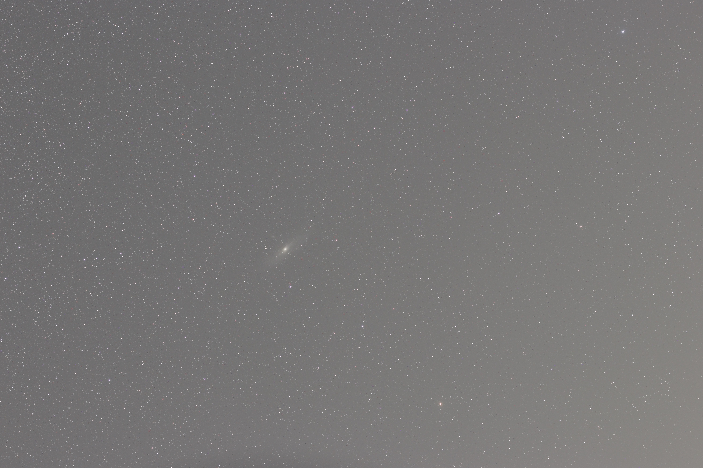
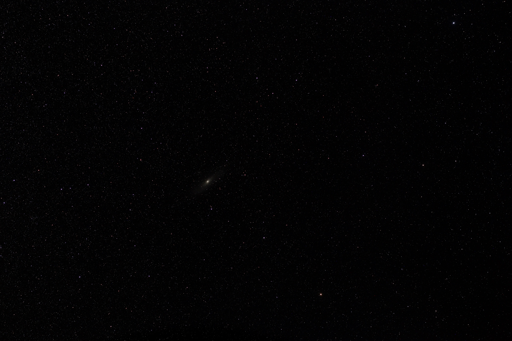

# SkyStacker

**Fast, lightweight, local-first Go CLI for astrophotography image stacking.**

> Drop a folder of (pre-aligned) JPG exposures. Get high-dynamic-range TIFF sum and mean images, plus previews and a detailed report.

[](https://opensource.org/licenses/MIT)
[](https://go.dev/)
[]()

SkyStacker is an open-source command-line tool written in Go that discovers and stacks astronomical images (currently JPG/JPEG) into integrated outputs. It emphasizes numerical precision, bounded memory use, reproducibility, and a minimal user experience. Version 0.1 performs pixel-wise sum and arithmetic mean in the existing coordinate system (no automatic registration or calibration yet).

**Current status:** Early MVP implementation available under `skystacker/v0/`. Suitable for testing with pre-aligned frames. Not a full replacement for mature suites.

## Why SkyStacker?

- **Lightweight & pure Go**: Single static binary, no heavy dependencies, easy cross-compilation.
- **Local-first & offline**: No accounts, cloud, or network required.
- **Precision-focused**: Floating-point (float32) accumulation to avoid 8-bit overflow; explicit TIFF float32 outputs.
- **Memory-conscious**: Streaming/tile-friendly design; does not load all frames at once.
- **Transparent**: Clear reports and explicit notes about what was (and was not) done.
- **Extensible foundation**: Modular architecture prepared for future registration, calibration, and advanced stacking.

Ideal for simple stacking of already-aligned sessions, batch automation, learning, or as a building block.

## 🌟 Visual Results & Processing Showcase

SkyStacker automates frame discovery, alignment, stacking, and an advanced post-processing pipeline (background gradient removal and contrast stretch) to transform raw astrophotography data into clean, high-dynamic-range images.

| Raw Stacked Image (Before Gradient Removal) | Final Post-Processed Output (After Pipeline) |
| :---: | :---: |
|  |  |
| *Heavy background light pollution, magenta cast, and washed-out contrast.* | *Cleaned background, neutralized sky, and enhanced stellar details.* |

## Quick Start

### Prerequisites
- Go 1.20 or later
- A directory of compatible JPG/JPEG frames (same dimensions recommended)

### Build
```bash
cd skystacker/v0
go build -o skystacker ./cmd/skystacker
```

### Run
```bash
# Process current directory
./skystacker

# Process a specific session
./skystacker ./night-session --workers 4 --output ./results
```

Outputs appear in `skystacker_results/` (or your chosen directory):
- `stacked_sum.tiff` / `stacked_sum.jpg` — raw sum (float32 TIFF + normalized preview)
- `stacked_mean.tiff` / `stacked_mean.jpg` — arithmetic mean
- `stacked_no_correction_mean.*` — identical to mean in v0.1 (placeholder for future registered comparison)
- `stacked_preview.jpg` — display preview
- `report.txt` — full processing report

**Important:** v0.1 does **not** align or calibrate frames. Use pre-registered images or expect blur if frames are misaligned.

## Features

### Implemented (v0.1)
- Automatic discovery of `.jpg` / `.jpeg` (case-insensitive, non-recursive by default)
- Input validation and graceful rejection of corrupt/incompatible files
- Float32 interleaved RGB accumulation (sum + mean)
- Concurrent processing with worker limit
- High-precision float32 TIFF outputs (uncompressed, little-endian)
- JPG display previews (with gamma stretch)
- Detailed `report.txt`
- Atomic writes, overwrite control, recursive option

### Planned
- Star detection and geometric registration (v0.2)
- Median, sigma-clipping, weighted stacking (v0.3)
- RAW / FITS support, dark/flat/bias calibration, background correction (v0.4+)
- More advanced quality metrics and rejection

## Comparative Feature Table

| Feature                        | SkyStacker (v0.1)          | DeepSkyStacker          | Siril                          | OpenSkyStacker             | Sequator                  |
|--------------------------------|----------------------------|-------------------------|--------------------------------|----------------------------|---------------------------|
| **License**                    | MIT                        | BSD-3                   | GPL                            | MIT                        | Freeware                  |
| **Platform**                   | Linux, Windows, macOS     | Windows (Mac experimental) | Win/Mac/Linux                 | Win/Mac/Linux             | Windows                   |
| **Interface**                  | CLI only                   | GUI                     | GUI + CLI/scripts              | GUI + CLI                 | GUI                       |
| **Registration / Alignment**   | No (planned)               | Yes                     | Yes                            | Yes                       | Yes (specialized)         |
| **Calibration (dark/flat/bias)** | No (planned)             | Yes                     | Yes                            | Partial                   | Limited                   |
| **Stacking methods**           | Sum, arithmetic mean       | Multiple (incl. median, sigma) | Multiple + advanced          | Mean/median etc.          | Specialized nightscape    |
| **Input formats**              | JPG/JPEG                   | RAW, FITS, TIFF, etc.   | RAW, FITS, TIFF, SER, etc.     | Various                   | JPG, RAW                  |
| **Output**                     | Float32 TIFF + JPG preview | 16/32-bit TIFF         | FITS, TIFF, etc.               | 32-bit TIFF               | JPG/TIFF                  |
| **Memory efficiency**          | High (streaming design)    | Good                    | Good                           | Good                      | Good                      |
| **Single binary / pure Go**    | Yes                        | No                      | No                             | No                        | No                        |
| **Best for**                   | Lightweight pre-aligned stacking, automation, foundation | Beginner deep-sky     | Full free workflow             | Cross-platform deep-sky   | Milky Way / nightscapes   |

SkyStacker deliberately starts simpler and more focused. It is not trying to replace Siril or DeepSkyStacker today; it aims to provide a clean, modern, portable core that can grow.

## Related Projects

Learn from and coexist with established tools:

- **[Siril](https://siril.org/)** ([GitHub](https://github.com/Astro-Siril/Siril)) — Mature open-source full pipeline (registration, calibration, stacking, post-processing, scripting). Cross-platform.
- **[DeepSkyStacker](https://github.com/deepskystacker/DSS)** — Classic, beginner-friendly deep-sky stacker (primarily Windows; open source since 2018).
- **[OpenSkyStacker](https://github.com/BenJuan26/OpenSkyStacker)** — Multi-platform deep-sky stacker with GUI and CLI.
- **[Sequator](https://sites.google.com/view/sequator/)** — Specialized for nightscape / Milky Way stacking (Windows).
- **[ASTAP](https://www.hnsky.org/astap.htm)** — Plate solving, stacking, and analysis tools.

## Building and Development

```bash
cd skystacker/v0
go test ./...
go build -o skystacker ./cmd/skystacker
```

Module path: `github.com/skystacker/skystacker` (adjust if needed for your fork).

---

## 🚀 Usage & Command Line Interface (CLI)

SkyStacker is designed as a lightweight, fast command-line tool. You can execute it directly by pointing it to your directory of raw frames.

### Basic Syntax

```bash
skystacker [flags]

```

### Available CLI Flags

| Flag | Shorthand | Description | Default |
| --- | --- | --- | --- |
| `--input` | `-i` | Path to the directory containing raw frames (RAW/TIFF) | `./input` |
| `--output` | `-o` | Path and filename for the final stacked output (TIFF) | `./output/stacked.tiff` |
| `--method` | `-m` | Stacking algorithm (`mean`, `median`, `clipped-mean`) | `mean` |
| `--postprocess` | `-p` | Enable/disable the advanced post-processing pipeline | `true` |
| `--bg-removal` | `-b` | Enable background gradient/light pollution removal | `true` |
| `--sharpen` | `-s` | Apply final unsharp masking / sharpening filter | `true` |
| `--export-steps` | `-e` | Export intermediate JPEG snapshots after each processing stage | `true` |
| `--help` | `-h` | Display help and usage information | `false` |

---

### Examples of Usage

#### 1. Standard Run with Full Post-Processing Pipeline

To stack all frames using the default mean algorithm and automatically execute the post-processing pipeline (generating intermediate JPEGs and the final cleaned image):

```bash
skystacker --input ./data/raw_frames --output ./output/final_result.tiff

```

#### 2. Fast Stacking without Post-Processing

If you only want the raw stacked image without applying gradient correction or contrast stretching:

```bash
skystacker --input ./data/raw_frames --output ./output/raw_stack.tiff --postprocess=false

```

#### 3. Using Median Stacking for Noise Reduction

To reduce cosmic rays or satellite trails using the median stacking operator before running the enhancement steps:

```bash
skystacker --input ./data/raw_frames --output ./output/median_stack.tiff --method median

```

---

## Design Principles

1. Correctness before speed.
2. Explicit behaviour (never claim alignment or calibration that did not happen).
3. Local-first.
4. Reproducibility.
5. Modularity.
6. Measured optimisation.

See `TECHNICAL_SPEC.md` for the full design document.

---

### ⚙️ Architecture & Processing Pipeline

SkyStacker follows a modular, high-performance processing pipeline designed in Go. The architecture separates frame discovery, alignment, accumulation, and advanced post-processing into discrete, testable stages.

#### Pipeline Flow Diagram

```text
[ Raw Image Set (RAW/TIFF) ]
           │
           ▼
  ┌──────────────────┐
  │  Frame Discovery │ ──> Scans directory, detects valid frames & metadata
  └──────────────────┘
           │
           ▼
  ┌──────────────────┐
  │ Alignment & Mesh │ ──> Detects stars, calculates offsets & geometric alignment
  └──────────────────┘
           │
           ▼
  ┌──────────────────┐
  │   Accumulation   │ ──> Merges frames via Mean/Median stacking algorithms
  └──────────────────┘
           │
           ▼ (Outputs high-dynamic-range intermediate stack)
  ┌────────────────────────────────────────────────────────┐
  │              Post-Processing Pipeline                  │
  │  ┌──────────────────────────────────────────────────┐  │
  │  │ 1. Background Gradient Removal (Light Pollution) │  │
  │  ├──────────────────────────────────────────────────┤  │
  │  │ 2. Histogram Stretch & Contrast Optimization     │  │
  │  ├──────────────────────────────────────────────────┤  │
  │  │ 3. Color Calibration & Background Neutralization │  │
  │  ├──────────────────────────────────────────────────┤  │
  │  │ 4. Sharpness Filter (Unsharp Masking / Details)  │  │
  │  └──────────────────────────────────────────────────┘  │
  └────────────────────────────────────────────────────────┘
           │
           ├───────────────────────────────┬───────────────────────────────┐
           ▼                               ▼                               ▼
 [ `post_step1_...jpg` ]       [ `post_step2_...jpg` ]       [ Final Processed TIFF & JPEG ]

```

#### Stage Breakdown

1. **Discovery (`internal/discovery`)**:
* Automatically inspects the target directory, validates input file headers, and filters usable astrophotography frames.


2. **Alignment (`internal/discovery` / `internal/imaging`)**:
* Detects stellar centroids and computes spatial transformation matrices to correct telescope drift between exposures.


3. **Accumulation (`internal/stack`)**:
* Combines aligned frames using robust statistical operators (such as clipped mean or median) to maximize signal-to-noise ratio (SNR) while rejecting cosmic rays or satellite trails.


4. **Post-Processing Pipeline**:
* **Background Subtraction:** Fits and subtracts smooth background gradients caused by light pollution or atmospheric scattering, isolating deep-sky objects.


* **Contrast Optimization:** Applies non-linear histogram stretching curves to reveal faint nebulae and spiral structures without clipping highlights.
* **Color Calibration:** Neutralizes unwanted color casts (e.g., magenta/red background glow) by balancing RGB black points.
* **Sharpening:** Enhances high-frequency details (star edges and galactic cores) using controlled unsharp masking filters.
* **Progressive JPEG Export:** Dumps an inspection snapshot (`.jpg`) after each step to allow real-time visual auditing of the processing stages.


---

## License

MIT License. See [LICENSE](LICENSE).

## Contributing

Contributions welcome! Priority areas:

- Improve registration and alignment
- Add more input formats and calibration
- Benchmarks and performance
- Documentation and test datasets
- Cross-platform CI

Please open an issue or PR. Review the technical specification first.

---

**Working tagline:** Fast. Local. Astronomical.  
**Status:** Early MVP — usable for basic stacking of compatible frames.
