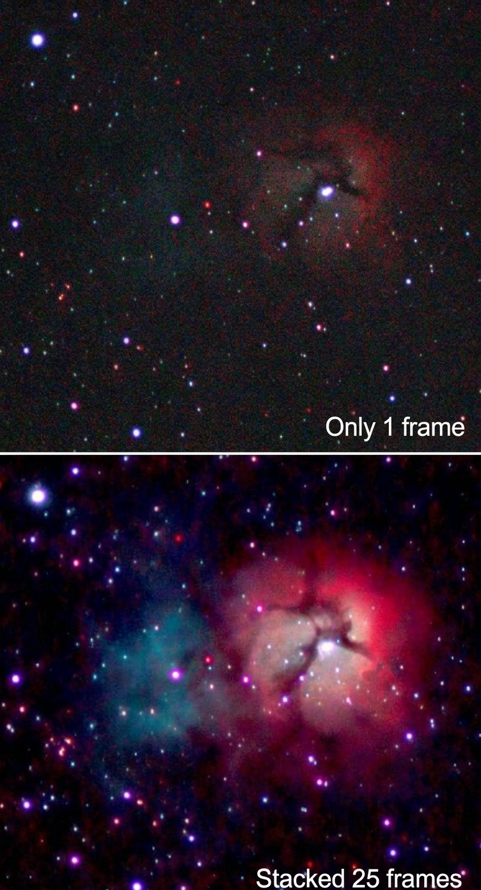
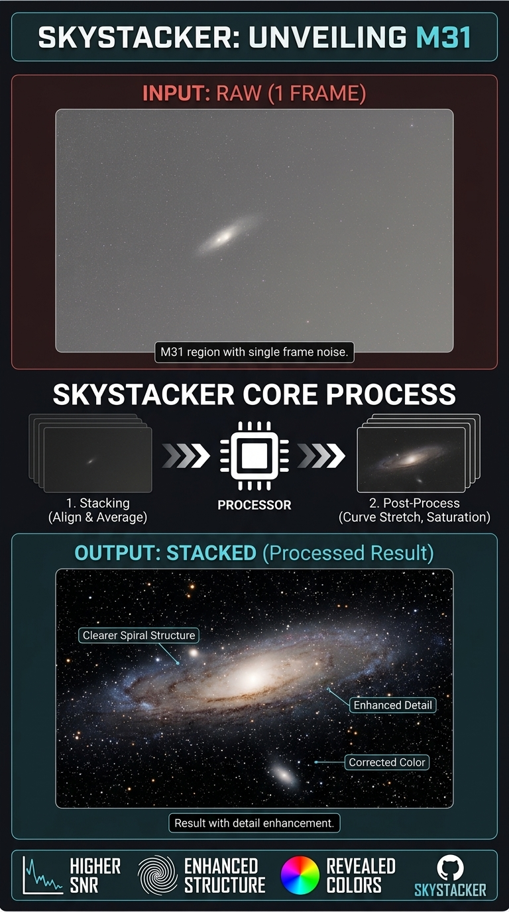
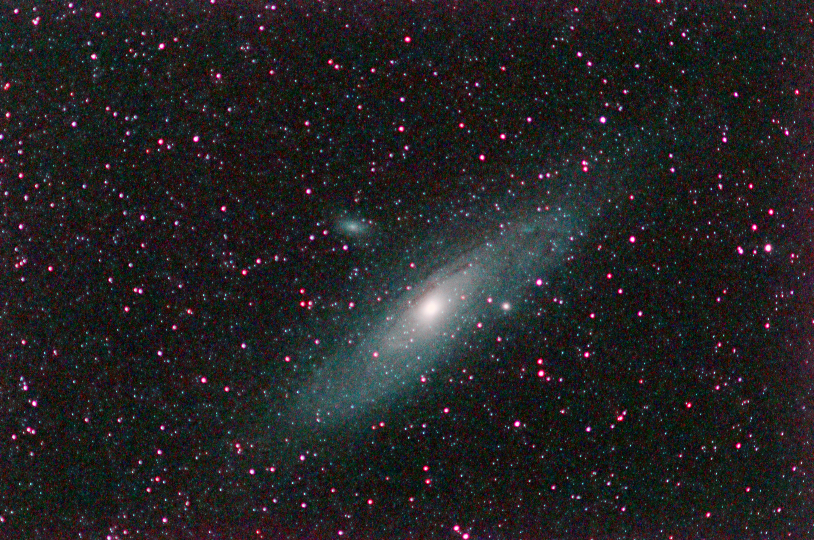
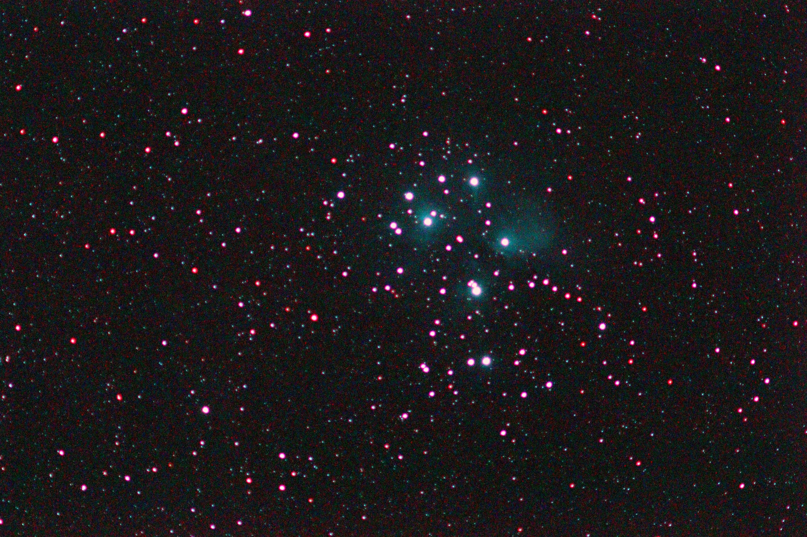
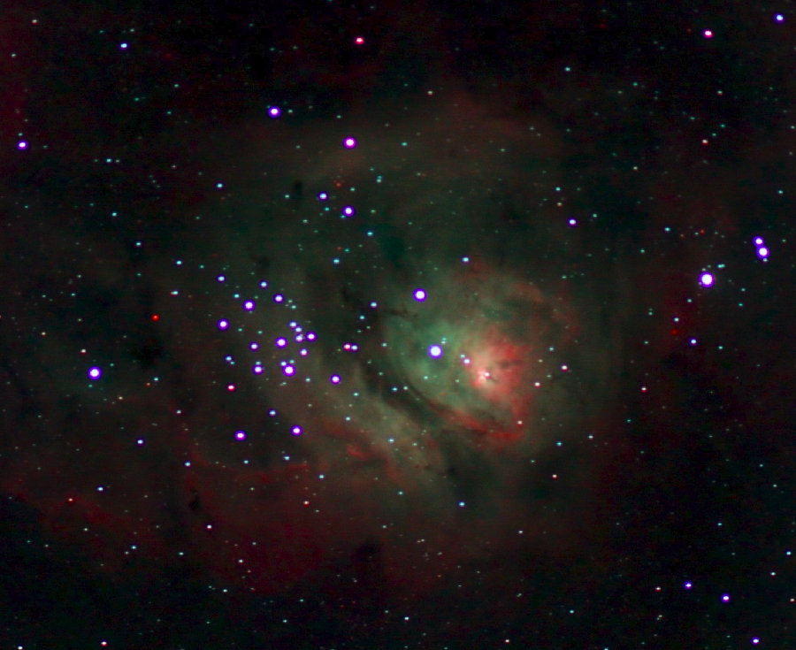
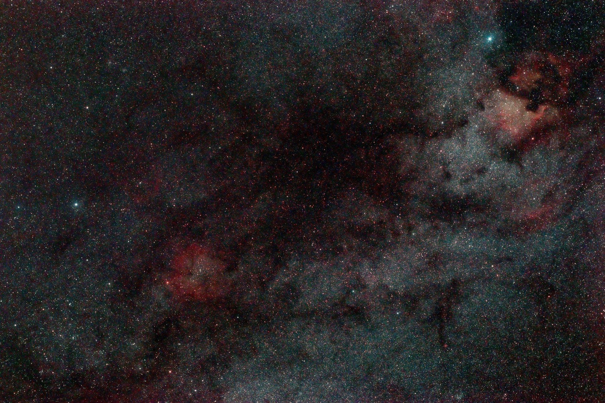

# SkyStacker

**SkyStacker is a local-first command-line tool for stacking astrophotography images.**  
It takes a folder of night-sky exposures, detects stars, aligns the frames, combines them into useful image stacks and can apply an automated post-processing workflow.

<p align="center">
  
</p>
<p align="center">
  <em>Stacking multiple frames dramatically improves signal-to-noise ratio and reveals faint structure (Trifid Nebula, 1 frame vs. 25 frames).</em>
</p>

<p align="center">
  
</p>
<p align="center">
  <em>From a folder of individual exposures to aligned stacks and processed astrophotography images.</em>
</p>

[](https://opensource.org/licenses/MIT)
[](https://go.dev/)
[]()

---

## Gallery

Examples of results produced with SkyStacker. More images will be added over time.

<table>
  <tr>
    <td align="center">
      <br>
      <strong>Galaxy — Andromeda (M31)</strong><br>
      <small>Spiral galaxy — the nearest large galaxy to the Milky Way, with visible dust lanes and companion M32.</small>
    </td>
    <td align="center">
      <br>
      <strong>Open Cluster — Pleiades (M45)</strong><br>
      <small>Young open star cluster surrounded by a blue reflection nebula of dust illuminated by the hot stars.</small>
    </td>
    <td align="center">
      <br>
      <strong>Nebula — Lagoon (M8)</strong><br>
      <small>Emission nebula and active star-forming region; the red Hα glow comes from ionized hydrogen gas.</small>
    </td>
    <td align="center">
      <br>
      <strong>Wide-field — North America Nebula region</strong><br>
      <small>Rich Milky Way field in Cepheus showing the North America Nebula (NGC 7000) and surrounding dust lanes.</small>
    </td>
  </tr>
</table>

---

## What does SkyStacker do?

Astrophotography sessions usually produce many individual exposures of the same region of the sky. Even when the camera or mount moves slightly between exposures, the stars should occupy the same positions in the final combined image.

SkyStacker automates the core workflow:

1. **Discovers input frames** in a session directory.
2. **Decodes the images** and prepares their pixel data.
3. **Optionally calibrates** light frames using dark, flat and bias frames.
4. **Detects stars** and selects a reference frame.
5. **Registers the frames** by matching star patterns and estimating geometric transformations.
6. **Resamples and aligns** the exposures before combining them.
7. **Creates image stacks** using the selected statistical method, plus maximum- and minimum-pixel combinations.
8. **Optionally post-processes** the resulting image to improve its background, colour, contrast and detail.
9. **Writes outputs and a processing report** to a results directory.

The aim is to provide a transparent, reproducible and resource-conscious workflow that runs locally, without requiring a cloud service.

## Main capabilities

### Frame registration

- Automatic star detection with sub-pixel centroid estimation.
- Reference-frame selection based on detected star count.
- Triangle-based star-pattern matching.
- Similarity-transform estimation and robust inlier filtering (RANSAC-style matching).
- Sub-pixel image resampling.
- Safe cropping to the region valid across registered frames.
- Frames that cannot be registered are reported and excluded from the registered stack; they can still contribute to the unregistered mean.

### Calibration

Calibration frames can be supplied explicitly:

- **Dark frames** help correct sensor dark signal and hot pixels.
- **Flat frames** help correct illumination variation and vignetting.
- **Bias frames** can be used with flat calibration.

You can pass individual calibration paths or use `--calib-root` to let SkyStacker look for calibration folders under a common directory.

### Stacking methods

| Method | Purpose |
| --- | --- |
| `mean` | Arithmetic average of registered frames. |
| `median` | Median combination, useful for rejecting transient features. |
| `sigma` | Sigma-clipping combination, intended to reject outliers such as hot pixels and transient signals. |

The default method is `sigma`.

SkyStacker also calculates maximum- and minimum-pixel combinations. These can be useful for inspecting transient features and background behaviour, although they are diagnostic combinations rather than substitutes for a normal integration.

### Post-processing

The post-processing workflow includes background removal and optional processing stages controlled by command-line flags:

- Background-gradient modelling and removal.
- Optional masking of bright objects during background extraction.
- Chromatic-aberration reduction.
- Colour calibration.
- Vignette/background flattening.
- Unsharp-mask sharpening.
- HDR local-contrast enhancement.
- Contrast stretching at gentle, moderate and full levels.
- Star removal and black-point adjustment in the current processing workflow.

The processing stages and their settings are evolving during development. Consult `skystacker --help` for the exact options available in the version you have built.

### Frame normalization (optional)

Sessions where individual frames have different sky brightness or transparency
benefit from normalization before stacking:

- `--normalize` — per-frame global scale+offset: matches each frame's
  background median and MAD to the reference frame's. Cheap (~1 ms/frame).
  Handles uniform sky-glow drift and transparency swings.
- `--local-normalize` — per-tile scale+offset with bilinear interpolation
  of the correction field (`--ln-tile-size`, default 256 px). Handles
  spatially varying gradients (light pollution, vignetting direction changes).
  Implies `--normalize`.

Both options require registration (the reference frame defines the target)
and are no-ops when `--no-register` is set. The reference frame itself is
never normalized; every other frame is corrected to match its background
before being accumulated or spilled.

## Supported input formats

SkyStacker currently discovers these extensions:

- `.jpg` and `.jpeg`
- `.cr2` and `.cr3`
- `.fit` and `.fits`

JPEG decoding is handled by Go's image packages. FITS decoding is handled natively (with ImageMagick as a fallback), and RAW decoding uses external command-line tools, so support depends on the relevant decoder being installed and available in `PATH`.

### External tools

On Debian/Ubuntu, install ImageMagick:

```bash
sudo apt update
sudo apt install imagemagick
```

For Canon RAW files, SkyStacker can use `dcraw` or `dcraw_emu` when available. Install a compatible RAW decoder if your system does not already provide one.

> **Note:** The exact RAW/FITS decoding capabilities depend on the ImageMagick delegates and RAW decoder installed on your system. A file extension alone does not guarantee that a particular camera file can be decoded.

## Requirements

- Go 1.20 or later.
- ImageMagick for the external RAW/FITS decoding paths.
- `dcraw` or `dcraw_emu` for the preferred Canon RAW decoding path, where required.
- A directory containing compatible astrophotography exposures.
- Enough RAM and disk space for the image dimensions and number of frames in the session.

SkyStacker includes memory-safety checks intended to warn about potentially excessive memory requirements. Avoid bypassing those checks unless you understand the resource implications.

## Build

Clone the repository and build the executable:

```bash
git clone https://github.com/computerphysicslab/skystacker.git
cd skystacker

go build -ldflags "-X main.buildDate=$(date -u +%Y-%m-%dT%H:%M:%SZ)" -o skystacker .
```

Run the internal self-tests:

```bash
./skystacker --selftest
```

Print the version or command-line help:

```bash
./skystacker --version
./skystacker --help
```

### Startup banner

On every run SkyStacker prints a one-line banner to standard error:

```text
SkyStacker 0.5.0 | https://github.com/computerphysicslab/skystacker | built 2026-11-12T12:00:00Z
```

To embed the real build time:

```bash
go build -ldflags "-X main.buildDate=$(date -u +%Y-%m-%dT%H:%M:%SZ)" -o skystacker main.go
```

Without `-ldflags`, SkyStacker falls back to the VCS commit time that Go
embeds when building from a Git checkout, or prints `unknown`.

## Quick start

Put the light frames from one imaging session in a directory, for example:

```text
M31-session/
├── light_001.jpg
├── light_002.jpg
├── light_003.jpg
└── ...
```

Run the default workflow:

```bash
./skystacker ./M31-session
```

By default, the results are written to:

```text
M31-session/0_skystacker_results/
```

Choose a different stacking method:

```bash
./skystacker --method mean ./M31-session
./skystacker --method median ./M31-session
./skystacker --method sigma ./M31-session
```

Use a separate output directory:

```bash
./skystacker --output ./results/M31 ./M31-session
```

Search subdirectories recursively:

```bash
./skystacker --recursive ./M31-session
```

Run stacking without post-processing:

```bash
./skystacker --stack-only ./M31-session
```

Run post-processing against existing intermediate data:

```bash
./skystacker --post-only ./M31-session
```

Allow replacement of existing output files:

```bash
./skystacker --overwrite ./M31-session
```

## Calibration example

A session may keep its light frames and calibration frames in separate directories:

```text
M31-session/
├── lights/
│   ├── light_001.cr2
│   ├── light_002.cr2
│   └── ...
└── calibration/
    ├── darks/
    ├── flats/
    └── bias/
```

Supply calibration files or directories explicitly:

```bash
./skystacker \
  --dark ./M31-session/calibration/darks/master-dark.fit \
  --flat ./M31-session/calibration/flats/master-flat.fit \
  --bias ./M31-session/calibration/bias/master-bias.fit \
  ./M31-session/lights
```

Or ask SkyStacker to search a calibration root:

```bash
./skystacker \
  --calib-root ./M31-session/calibration \
  ./M31-session/lights
```

Use calibration frames with matching camera, sensor settings, exposure/gain and relevant acquisition conditions. Calibration is only as reliable as the calibration data supplied.

## Command-line options

The command syntax is:

```bash
skystacker [flags] [input-directory]
```

The input directory defaults to the current directory (`.`). Flags can be supplied before or after the positional input directory.

| Flag | Description | Default |
| --- | --- | --- |
| `--output string` | Output directory | `<input>/0_skystacker_results` |
| `--method string` | Stacking method: `mean`, `median` or `sigma` | `sigma` |
| `--workers int` | Maximum number of concurrent workers | Number of CPUs |
| `--recursive` | Search input subdirectories recursively | `false` |
| `--overwrite` | Permit replacing files in the output directory | `false` |
| `--no-register` | Disable star-based registration | `false` |
| `--dark string` | Dark frame or calibration path | — |
| `--flat string` | Flat frame or calibration path | — |
| `--bias string` | Bias frame or calibration path | — |
| `--calib-root string` | Root directory containing Bias/Darks/Flats folders | — |
| `--stack-only` | Stack frames and skip post-processing | `false` |
| `--no-postprocess` | Alias for `--stack-only` | `false` |
| `--post-only` | Run post-processing using existing intermediate data | `false` |
| `--mask-bg` | Mask bright objects during background extraction | `false` |
| `--bg-degree int` | Background polynomial degree (1–3) | `2` |
| `--stretch float` | Asinh stretch factor | `10` |
| `--sharpen-amount float` | Unsharp-mask amount | `0.8` |
| `--sharpen-radius float` | Unsharp-mask radius in pixels | `1.5` |
| `--hdr-amount float` | HDR local-contrast amount | `0.5` |
| `--star-radius int` | Star-removal radius in pixels; `0` selects automatic sizing | `0` |
| `--star-sigma float` | Star-detection threshold in sigma units | `4` |
| `--bg-percentile float` | Luminance percentile used for black-point adjustment; `0` disables it | `10` |
| `--scale int` | Downscaling factor; `2` halves each dimension, `4` quarters it | `1` |
| `--force` | Skip the out-of-memory safety check (not recommended) | `false` |
| `--tiff` | Write the optional TIFF sum output | `false` |
| `--post-ca` | Enable chromatic-aberration reduction | `false` |
| `--post-color` | Enable colour calibration | `false` |
| `--post-flatten` | Enable vignette/background flattening | `false` |
| `--post-sharpen` | Enable unsharp-mask sharpening | `false` |
| `--post-hdr` | Enable HDR local contrast | `false` |
| `--post-stretch` | Enable the three-level contrast stretch | `false` |
| `--no-color-calib` | Skip colour calibration | `false` |
| `--no-sharpen` | Skip sharpening | `false` |
| `--no-auto-stretch` | Skip the final STF/MTF auto-stretch | `false` |
| `--stf-shadows float` | STF shadow clip in sigma units | `-2.8` |
| `--stf-target float` | STF target background level | `0.25` |
| `--stf-linked` | Use linked channels for STF (auto colour balance) | `false` |
| `--no-hdr-blend` | Skip the step-7 HDR blend | `false` |
| `--hdr-blend-factor float` | HDR blend amount: step6 + F·step1 | `1.0` |
| `--no-hdr-mix` | Skip the 4 step-8 weighted-mix outputs | `false` |
| `--no-denoise` | Skip guided-filter denoise | `false` |
| `--denoise-strength float` | Denoise passes (0=skip, N=iterations, max 10) | `4.0` |
| `--denoise-radius int` | Guided-filter denoise radius | `3` |
| `--denoise-chroma float` | Chroma denoise iterations (0 disables) | `1.0` |
| `--no-curves` | Skip the curves step | `false` |
| `--curves-black float` | Curves shadow crush point, [0, 0.5) | `0.03` |
| `--curves-gamma float` | Curves midtone gamma (>1 darkens) | `1.20` |
| `--spikes` | Add diffraction spikes to bright stars | `true` |
| `--no-spikes` | Disable diffraction spikes | `false` |
| `--spikes-percent float` | Percent of detected stars to spike (0-50) | `0.2` |
| `--spikes-length float` | Spike arm half-length in pixels | `10` |
| `--spikes-intensity float` | Peak additive spike brightness | `0.3` |
| `--spikes-arms int` | Number of spike arms (4=cross, 6=hex) | `4` |
| `--spikes-softness float` | Intensity falloff exponent | `0.5` |
| `--spikes-min-ratio float` | Intensity floor for faintest spiked star | `0.2` |
| `--spikes-length-softness float` | Length falloff exponent | `1.0` |
| `--spikes-length-min-ratio float` | Length floor for faintest spiked star | `0.03` |
| `--spikes-min-count int` | Minimum number of stars to spike | `5` |
| `--sigma-clip float` | MAD sigma-clipping threshold (0 disables) | `3.0` |
| `--sigma-clip-iters int` | Sigma-clipping iterations | `2` |
| `--tile-size int` | Tile side length for median/sigma (0=auto) | `0` |
| `--normalize` | Per-frame global scale+offset to reference (needs registration) | `false` |
| `--local-normalize` | Per-tile scale+offset; implies `--normalize` | `false` |
| `--ln-tile-size int` | Tile size for `--local-normalize` | `256` |
| `--no-exif` | Skip EXIF exposure summary in report | `false` |
| `--no-cache` | Disable the star/transform cache | `false` |
| `--clean` | Remove `_work` directory after successful run | `false` |
| `--cache-dir string` | Cache directory (default `<output>/_work/cache`) | — |
| `--selftest` | Run internal self-tests and exit | — |
| `--version` | Print version and exit | — |
| `--help` | Print command-line help | — |

For the authoritative list and defaults in your checked-out build, run:

```bash
./skystacker --help
```

## Output

SkyStacker creates a `0_skystacker_results/` directory by default (or the directory selected with `--output`).

Depending on the selected workflow and enabled options, it can contain:

- Registered and unregistered stack products.
- Maximum- and minimum-pixel diagnostic stacks.
- TIFF data products when requested.
- JPEG previews from post-processing stages.
- Intermediate working data used by the post-processing pass.
- `report.txt`, containing processing information and per-frame outcomes.

The precise set of files depends on the version, flags and input data. The report is the best place to check which frames were loaded, registered, skipped or processed.

## Processing pipeline at a glance

```text
Astrophotography session
        │
        ▼
 Discover JPG / JPEG / CR2 / CR3 / FIT / FITS
        │
        ▼
 Decode frames and estimate resource requirements
        │
        ▼
 Optional dark / flat / bias calibration
        │
        ▼
 Detect stars and choose a reference frame
        │
        ▼
 Match star patterns and register frames
        │
        ▼
 Resample, align and crop valid image area
        │
        ▼
 Mean / Median / Sigma stacking
        │
        ├── Maximum-pixel stack
        ├── Minimum-pixel stack
        └── Optional TIFF output
        │
        ▼
 Background and optional image processing
        │
        ▼
 JPEG previews + image products + report
```

## Development status

SkyStacker is under active development. The repository currently uses a single-file implementation in `main.go`; the version reported by the current source is **0.5.0**.

The feature set, output names and command-line interface may change between development revisions. Treat the source code and `--help` output from the checked-out commit as authoritative.
## Recently implemented (v0.5.0)

The following items from the original roadmap have been implemented in 0.5.0:

- **Frame quality weighting** — registered frames are weighted by
  `computeFrameQuality × computeIntrinsicQuality / 100`; unregistered frames
  by intrinsic quality alone. Weights visible per-frame in `report.txt`
  (`IntrQ` and `Weight` columns).
- **Per-frame normalization** — `--normalize` scales each frame's sky
  background (median + MAD) to match the reference frame.
- **Local normalization correction** — `--local-normalize` applies the same
  correction per tile with bilinear interpolation of the correction field,
  catching spatially varying sky gradients and transparency changes.
- **Star / transform cache** — re-runs skip Pass 1 detection and
  Pass 2 registration via JSON files under `<output>/_work/cache/`.
  Disable with `--no-cache`; override the location with `--cache-dir`.
- **Adaptive rejection and maps** — MAD-based sigma clipping (default 3σ,
  2 iterations), plus per-pixel rejection and weight maps
  (`stacked_rejection_map.jpg`, `stacked_weight_map.jpg`; plus
  `stacked_unregistered_rejection_map.jpg`, `stacked_unregistered_weight_map.jpg`
  when registration succeeds, and a full-frame `stacked_coverage_map.jpg`).
  The rejection map is the frame's cosmic-ray / hot-pixel candidate map: sigma
  clipping rejects exactly the extreme outliers, so bright spots there are
  cosmic-ray or hot-pixel hits.

## Planned Potential Features and Technologies Roadmap

To evolve SkyStacker into a more complete scientific astrophotography preprocessing and image-processing platform, the following features and technologies are planned for future integration:

### 1. Advanced Stacking & Image Integration
* **Frame quality weighting**: Combine SNR, FWHM, eccentricity, and background measurements ($Q_i = w_1 \text{SNR}_i - w_2 \text{FWHM}_i - w_3 E_i - w_4 B_i$) to give sharper, cleaner frames more influence.
* **Local Normalization Correction (LNC)**: Reduce differences in background and illumination between individual frames.
* **Drizzle & Bayer Drizzle Integration**: Recover better sampling from undersampled data and improve colour reconstruction without conventional demosaicing first.
* **Adaptive Rejection & Maps**: Iterative sigma-clipping, MAD, asymmetric thresholds, and generation of per-pixel rejection and weight maps.
* **Per-Frame Normalization**: Additive, multiplicative, and scaling normalization to handle sky brightness and transparency variations.

### 2. Advanced Star Detection & Optical Modelling
* **PSF Modelling & HFR**: Gaussian and Moffat profiles, Half Flux Radius (HFR) measurement, and elliptical Gaussian fitting for tracking errors, tilt, or coma.
* **Astrometric Plate Solving & WCS**: Automatic celestial coordinate identification using Astrometry.net and local Gaia catalogues, storing WCS metadata and SIP polynomial distortion coefficients.

### 3. Advanced Photometric & Colour Calibration
* **Photometric & Spectrophotometric Colour Calibration (PCC / SPCC)**: Use stellar spectral information from Gaia DR3 combined with camera sensor response and filter transmission characteristics.
* **Narrowband & Advanced Calibration**: Support for monochrome H-alpha, OIII, and SII filters with custom mappings (HOO, SHO, LRGB), dark-frame scaling, Bad Pixel Maps (BPM), and separate RGB channel normalization.

### 4. Advanced Background Extraction & Post-Processing
* **Multiscale Background Modelling**: Sample-based extraction, robust polynomial fitting protecting extended astronomical objects, and multiscale wavelet processing.
* **PSF-Based Deconvolution**: Richardson-Lucy, Wiener filtering, and regularized deconvolution to recover fine details lost to atmospheric seeing.
* **Star Separation**: Generate starless images and independent star layers for isolated nebular processing.
* **Advanced Noise Reduction**: Multiscale noise estimation and spatially adaptive denoising.

### 5. New Astrophotography Processing Modes
* **Multi-Night Integration**: Intelligent session classifiers, cross-session normalization, and calibration matching across nights.
* **Mosaic Construction**: Multi-panel alignment, overlap-based photometric normalization, feathered blending, and multiband seam elimination.
* **Comet & Moving-Object Stacking**: Dual registration preserving both star-aligned and comet-aligned structures.

### 6. High-Performance Computing & GPU Acceleration
* **Hardware Abstraction Layer**: Optional CUDA, OpenCL, and Vulkan Compute support alongside optimized SIMD/AVX2/AVX-512 CPU pixel operations and memory-mapped tiles.

### 7. Artificial Intelligence & Machine Learning (Optional Modules)
* **Optional AI Tools**: CNN/U-Net AI denoising, automated star removal, anomaly-based defect detection, and ML regression frame selection.

### 8. Scientific Interoperability & Interchange Formats
* **Expanded Formats**: Full support for XISF, FITS with compression, SER video sequences, and RAW/DNG ingestion while preserving acquisition metadata and calibration provenance.

### 9. Automation, Observability & Architecture
* **Robust Workflow Control**: Processing cache, checkpoint and resume capabilities, YAML/JSON pipeline configuration files, structured JSON telemetry reports, a modular plugin architecture, and an optional REST API.

---

## How SkyStacker compares

See [COMPARISON.md](COMPARISON.md) for a feature comparison with DeepSkyStacker,
Siril, Astro Pixel Processor, PixInsight, Sequator, ASTAP, IRIS, Nebulosity,
MaxIm DL, AstroImageJ, Starry Landscape Stacker and AutoStakkert!.

## Project goals

- **Local-first:** process astrophotography data on the user's own machine.
- **Transparent:** make processing steps and per-frame outcomes inspectable.
- **Resource-conscious:** estimate memory needs and provide safeguards.
- **Numerically careful:** use floating-point image data for accumulation and processing.
- **Practical:** provide a straightforward CLI and useful intermediate outputs.

## License

SkyStacker is distributed under the [MIT License](LICENSE).
