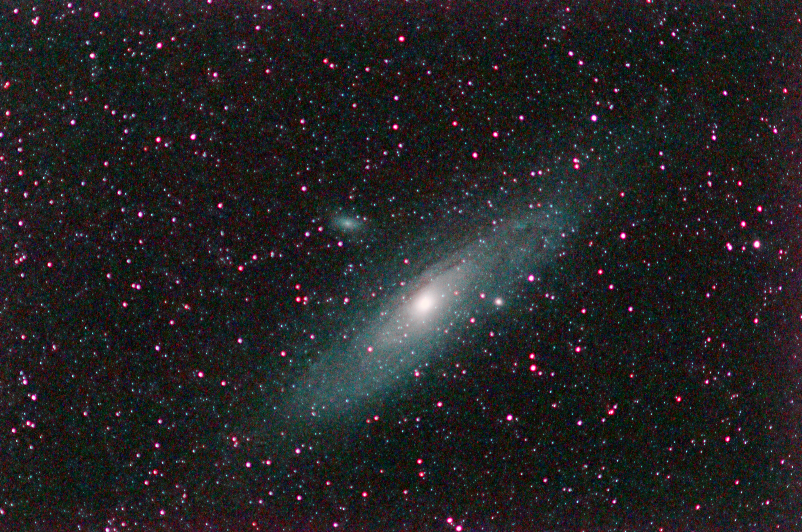
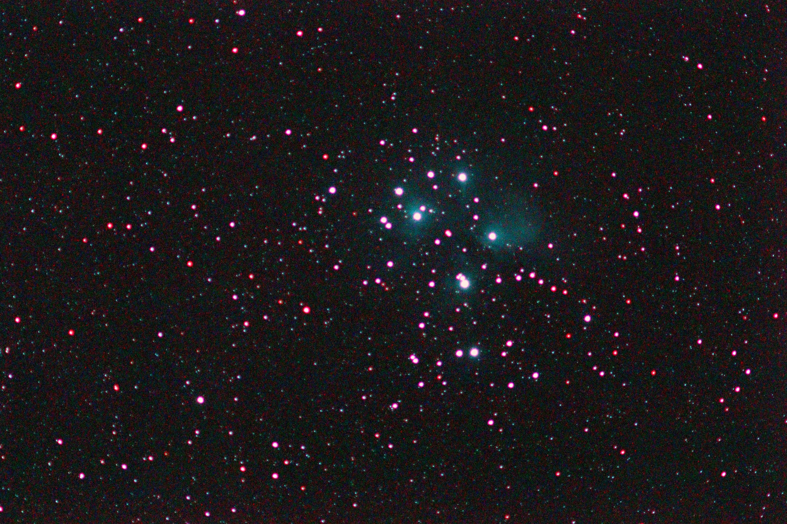
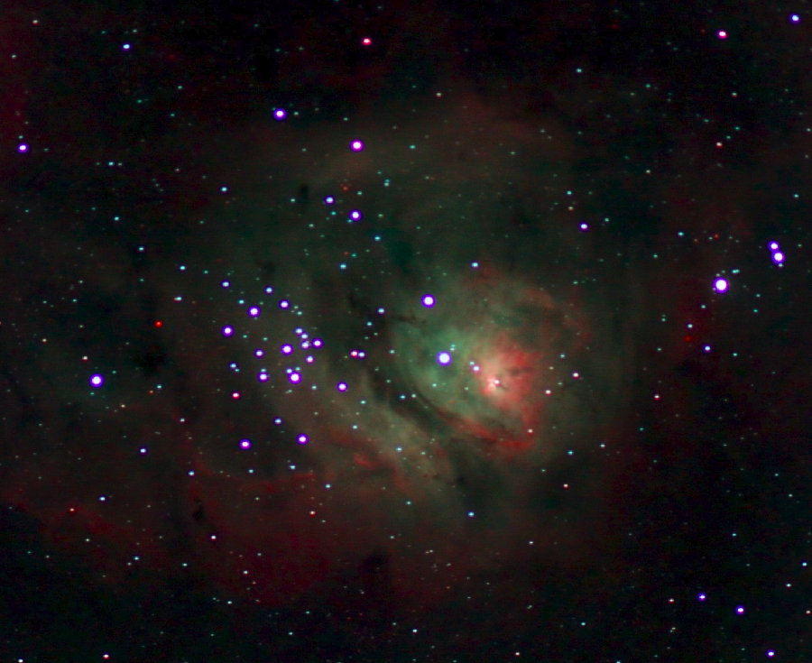
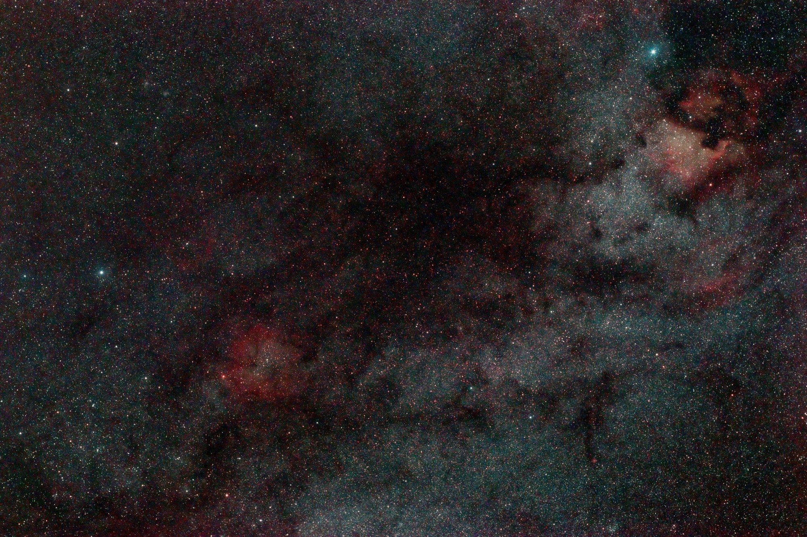

## Gallery

Examples of results produced with SkyStacker. More images will be added over time.

<table>
  <tr>
    <td align="center">
       
      <strong>Galaxy — Andromeda (M31)</strong> 
      <small>Spiral galaxy — the nearest large galaxy to the Milky Way, with visible dust lanes and companion M32.</small>
    </td>
    <td align="center">
       
      <strong>Open Cluster — Pleiades (M45)</strong> 
      <small>Young open star cluster surrounded by a blue reflection nebula of dust illuminated by the hot stars.</small>
    </td>
    <td align="center">
       
      <strong>Nebula — Lagoon (M8)</strong> 
      <small>Emission nebula and active star-forming region; the red Hα glow comes from ionized hydrogen gas.</small>
    </td>
    <td align="center">
       
      <strong>Wide-field — North America Nebula region</strong> 
      <small>Rich Milky Way field in Cepheus showing the North America Nebula (NGC 7000) and surrounding dust lanes.</small>
    </td>
  </tr>
</table>
